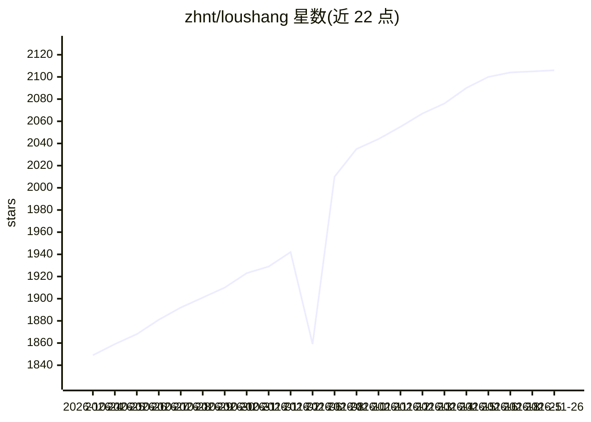

# zhnt/loushang

⭐ 2,106 · Python · Apache-2.0 · 推送 2026-11-25 · [GitHub](https://github.com/zhnt/loushang) · 个人维护 · 中文 README

**面向开发者的 AI 编码 agent CLI：意图到可验证交付**

基于 Python 的 AI-native agent harness，当前产品为 `loushang code` CLI 与终端工作台，提供模型路由、持久会话（恢复/分叉/导出/诊断）、工具治理、项目级扩展钩子与方法引导的交付流程；同时提供 `loushang.ai` SDK（模型注册、流式、工具调用、成本辅助）。使用前需配置所选 provider 的 API key 或 OAuth。项目处于早期开发阶段，推荐从源码运行，Makefile 提供 bootstrap 与本地二进制安装目标。

## 筛选速览

| 维度 | 判定 | 备注 |
|---|---|---|
| AI 角色 | `ai-ecosystem` | LLM/agent 周边工具 |
| 许可风险 | `permissive` | Apache-2.0 |
| 部署形态 | `None` |  |
| 模型依赖 | — | README 未给出锁定关系 |
| 硬件要求 | — | 无带数字的原话,不猜 |
| 安装摩擦 | `medium` | 含编译或系统依赖之一 |
| 成熟度 | `idea` | |

## 能力要点

- 多模型路由：GPT、Claude、DeepSeek、Qwen、Kimi、GLM、MiniMax（见仓库描述）
- 持久会话支持恢复、分叉、导出与诊断
- 方法/阶段/角色/工具作为运行时对象的治理机制
- 项目级扩展：钩子、自定义工具、动态资源与命令

## 适用场景

- 用 CLI 把复杂编码任务从意图推进到经验证的交付
- 需要可恢复、可审计的有状态 agent 编码会话
- 统一接入多家 LLM provider 并做模型路由与成本管理

## 场景标签

`编码 Agent` · 领域:编码与开发

## 证据(README 行号)

> L7: Current focus: `loushang code`, a CLI and terminal workbench for software development with model routing, persistent
> L15: Method is the work contract, work is the runtime fact, agent is the execution kernel, ai is the model access layer,
> L20: - `loushang.ai`: a provider-aware AI SDK with model registry, streaming, tool calls, and cost helpers.

## 星数曲线

2026-10-24 1,849 → 2026-11-26 2,106（+257）

---
*卡片 v1 · prompt 1.4 · 生成 2026-11-23 · 置信度 high · 依据 README sha `3279fa3f288e` · [字段定义](../../DATASET.md)*
