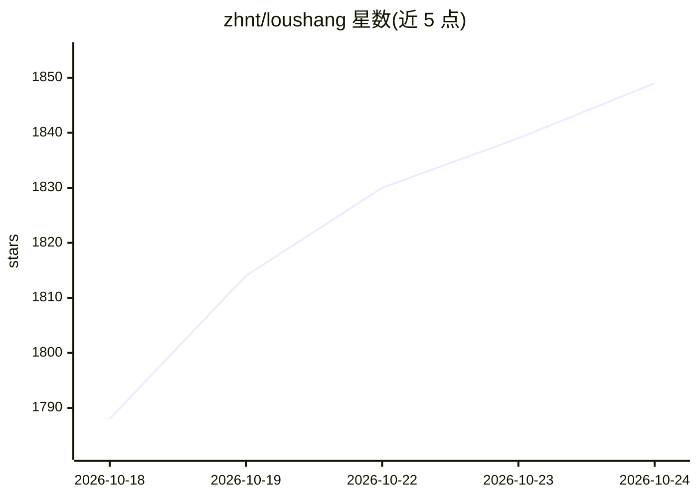

# zhnt/loushang

⭐ 1,849 · Python · Apache-2.0 · 推送 2026-10-23 · [GitHub](https://github.com/zhnt/loushang) · 个人维护 · 中文 README

**Python 编写的 AI-native 编码工作流 agent harness（CLI 终端工作台）**

面向软件开发的 CLI 与终端工作台 `loushang code`，以方法（Method）作为工作契约，将阶段、角色、工具、会话与工作产物作为运行时对象管理。提供持久化可恢复/可分叉/可导出的编码会话、内置编码工具与可配置工具面、项目级扩展钩子，以及带模型注册表、流式、工具调用与成本统计的 provider-aware AI SDK（loushang.ai），通过模型目录解析具体模型服务商端点。当前处于早期开发阶段，推荐从源码运行（git clone + make bootstrap），路线图上的 work/research/ppt 表面为演进方向。

## 筛选速览

| 维度 | 判定 | 备注 |
|---|---|---|
| AI 角色 | `ai-ecosystem` | LLM/agent 周边工具 |
| 许可风险 | `permissive` | Apache-2.0 |
| 部署形态 | `None` |  |
| 模型依赖 | — | README 未给出锁定关系 |
| 硬件要求 | — | 无带数字的原话,不猜 |
| 安装摩擦 | `medium` | 含编译或系统依赖之一 |
| 成熟度 | `idea` | |

## 能力要点

- 持久化编码会话：可恢复、分叉、导出与诊断
- provider-aware AI SDK：模型注册表、流式、工具调用、成本辅助
- 项目级扩展：钩子、自定义工具、动态资源与命令
- 方法引导（method-guided）的编码轮次与可复用工作流资产

## 适用场景

- 在终端里用多模型 agent 执行从意图到可验证交付的编码任务
- 需要会话可恢复、可审计的长期编码工作流
- 通过项目级扩展为 agent 注入自定义工具与命令

## 场景标签

`编码 Agent` · 领域:编码与开发

## 证据(README 行号)

> L7: Current focus: `loushang code`, a CLI and terminal workbench for software development with model routing, persistent
> L20: - `loushang.ai`: a provider-aware AI SDK with model registry, streaming, tool calls, and cost helpers.

## 星数曲线

2026-10-18 1,788 → 2026-10-24 1,849（+61）

---
*卡片 v1 · prompt 1.4 · 生成 2026-10-21 · 置信度 high · 依据 README sha `481208416fd2` · [字段定义](../../DATASET.md)*
