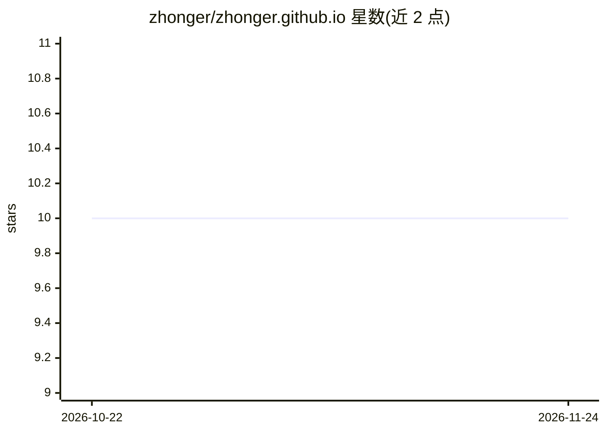

# zhonger/zhonger.github.io

⭐ 10 · Ruby · CC-BY-SA-4.0 · 推送 2026-09-09 · [GitHub](https://github.com/zhonger/zhonger.github.io) · [官网](https://lisz.me) · 个人维护 · 中文 README

**个人技术博客源码仓库：多节点托管的前端/后端/机器学习文章**

zhonger 的个人博客站点源码，基于 Jekyll 及 jekyll-theme-H2O-ac 主题构建，内容覆盖前端、后端、运维、技术架构与机器学习等主题。README 主要记录多节点访问架构：同一内容托管在 Netlify、GitHub、Cloudflare、阿里云、腾讯云 EdgeOne、Vercel、Azure、4everland 等多个平台，各节点提供不同域名与 IPv4/IPv6 支持情况。文章内容以 CC 4.0 协议发布，禁止未经授权的镜像发布，主题使用者被引导至独立主题仓库。

## 筛选速览

| 维度 | 判定 | 备注 |
|---|---|---|
| AI 角色 | `ai-knowledge` | 知识聚合/清单类 |
| 许可风险 | `viral` | CC-BY-SA-4.0 |
| 部署形态 | `None` |  |
| 模型依赖 | — | README 未给出锁定关系 |
| 硬件要求 | — | 无带数字的原话,不猜 |
| 安装摩擦 | `low` | 无编译、无系统依赖或容器化 |
| 成熟度 | — | 结构信号不足 |

## 能力要点

- 基于 jekyll-theme-H2O-ac 主题的 Jekyll 博客
- 同一内容多平台多节点托管（Netlify/GitHub/Cloudflare/腾讯云等），含 IPv4/IPv6 支持表
- 文章内容以 CC 4.0 协议分享

## 适用场景

- 在多个托管平台上部署同一 Jekyll 博客以提升可访问性
- 参考多节点博客的托管与域名配置方案
- 查阅前端、运维、机器学习等技术主题文章

## 场景标签

 · 领域:个人博客/静态站点

## 证据(README 行号)

> L3: - 采用基于 jekyll-theme-H2O 的 jekyll-theme-H2O-ac 主题；
> L4: - 主要包含 **前端、后端、运维、技术架构、机器学习** 等主题的内容。

## 星数曲线

2026-10-22 10 → 2026-11-24 10（+0）

---
*卡片 v1 · prompt 1.4 · 生成 2026-11-19 · 置信度 high · 依据 README sha `1661f881c17e` · [字段定义](../../DATASET.md)*
