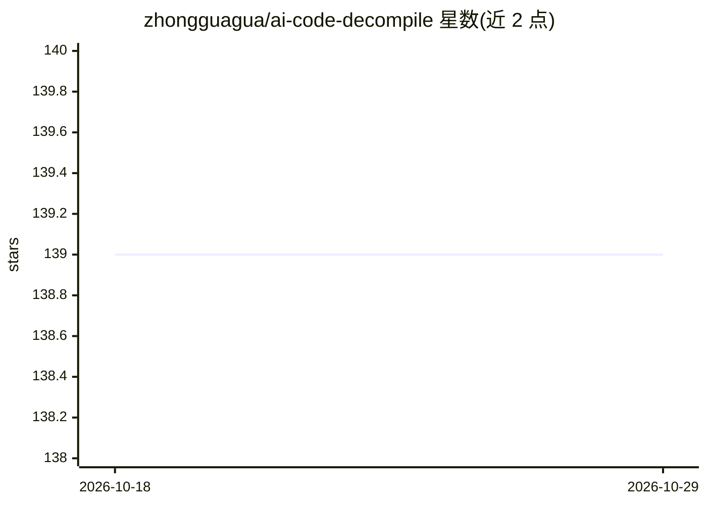

# zhongguagua/ai-code-decompile

⭐ 139 · TypeScript · 推送 2026-01-07 · [GitHub](https://github.com/zhongguagua/ai-code-decompile) · [官网](https://www.jsunpack.tech/) · 组织维护 · 中文 README

**AI 驱动的 JS 反编译分析工具 JSUnpack 的前端界面**

JSUnpack 是基于 AI 的 JavaScript 反编译与分析工具，面向需要理解打包、压缩、混淆后前端产物的开发者；本仓库仅为其前端开源实现，包含 UI 与交互逻辑，技术栈为 React/Next.js/TypeScript/Tailwind。分析能力包括上下文级代码逻辑分析、变量与函数用途推测、第三方库识别。声明不以 100% 还原原始源码为目标，仅供学习、分析与问题定位。本地运行需 Node>=18，通过 npm install 与 npm run dev 启动。

## 筛选速览

| 维度 | 判定 | 备注 |
|---|---|---|
| AI 角色 | `ai-native` | 本体是模型或模型工具 |
| 许可风险 | `none` | — |
| 部署形态 | `library` | 以包/库形式分发 |
| 模型依赖 | — | README 未给出锁定关系 |
| 硬件要求 | — | 无带数字的原话,不猜 |
| 安装摩擦 | `low` | 无编译、无系统依赖或容器化 |
| 成熟度 | — | 结构信号不足 |

## 能力要点

- 基于上下文分析混淆代码逻辑并识别模块结构
- 推测变量/函数用途，自动识别常见第三方库
- 适用于多入口、多 chunk 的真实构建产物
- 本仓库为前端实现，仅含 UI 与交互逻辑

## 适用场景

- 没有源码时分析某网站的交互或整体实现方案
- 排查线上问题、理解历史遗留的前端产物
- 技术调研中分析竞品站点的实现方式（合法合规场景）

## 场景标签

 · 领域:软件开发工具/代码分析

## 证据(README 行号)

> L5: **JSUnpack** 是一个基于 AI 的 JavaScript 反编译与分析工具，
> L65: 本仓库为 **JSUnpack 的前端开源实现**，

## 星数曲线

2026-10-18 139 → 2026-10-29 139（+0）

---
*卡片 v1 · prompt 1.4 · 生成 2026-10-23 · 置信度 high · 依据 README sha `2ca9cc130651` · [字段定义](../../DATASET.md)*
