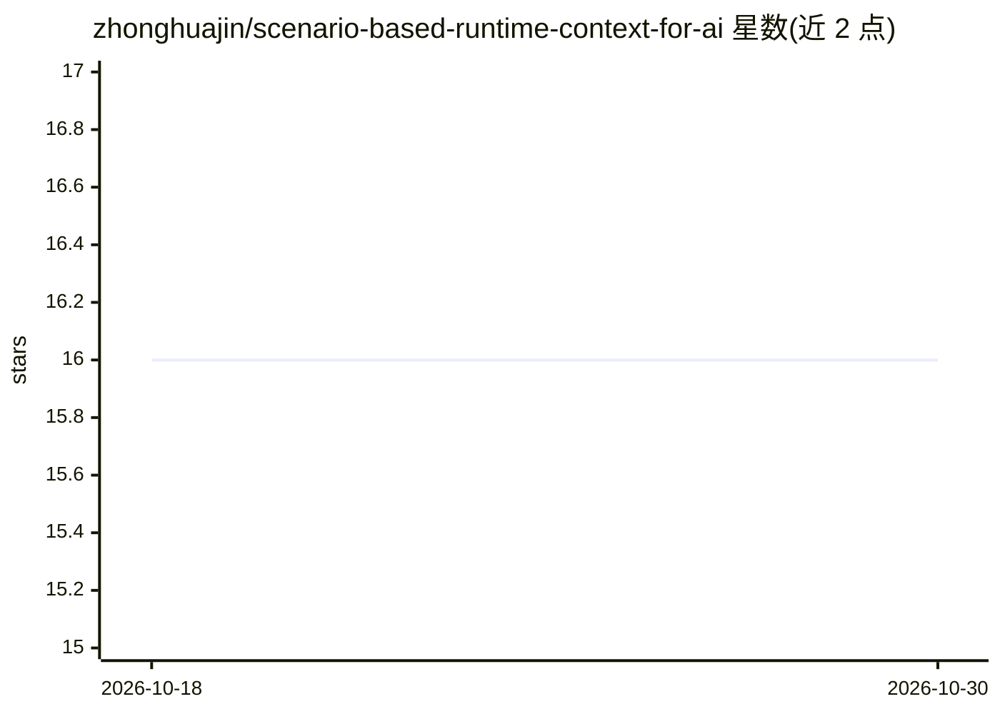

# zhonghuajin/scenario-based-runtime-context-for-ai

⭐ 16 · Java · MIT · 推送 2026-05-03 · [GitHub](https://github.com/zhonghuajin/scenario-based-runtime-context-for-ai) · 个人维护 · 中文 README

**论证用运行时证据构建低噪 AI 代码上下文的方法库**

收录文章与概念验证：通过源码插桩采集真实执行的运行时证据（调用树、条件求值报告），经去噪后生成面向 LLM 的场景化代码上下文，用于调试特定行为、解释失败原因，目标是减少模型基于静态结构的猜测性幻觉。evidence/ 目录收录针对真实开源项目（如 Spring Boot 三个已确认 issue）的案例，含原始运行时工件、去噪上下文与 LLM 诊断回复。作者声明定位为方法验证仓库，不提供生产级工具，企业级议题另在 engineering/ 讨论。

## 筛选速览

| 维度 | 判定 | 备注 |
|---|---|---|
| AI 角色 | `ai-knowledge` | 知识聚合/清单类 |
| 许可风险 | `permissive` | MIT |
| 部署形态 | `None` |  |
| 模型依赖 | — | README 未给出锁定关系 |
| 硬件要求 | — | 无带数字的原话,不猜 |
| 安装摩擦 | `low` | 无编译、无系统依赖或容器化 |
| 成熟度 | `idea` | |

## 能力要点

- 源码插桩→运行时日志采集→去噪→AI prompt 生成的概念验证流水线
- evidence/ 收录真实开源项目案例（含调用树、去噪上下文、LLM 诊断回复）
- 以 Spring Boot 已确认 issue 演示方法有效性
- 自述为方法论验证仓库，非生产级工具

## 适用场景

- 我想了解运行时证据如何降低 AI 代码分析的幻觉
- 调试特定运行行为时，参考只喂实际执行路径的上下文构建方式
- 查阅真实开源项目上运行时诊断的案例工件

## 场景标签

`科研工具` · 领域:学习与行业

## 证据(README 行号)

> L3: **Essays, and poc on using runtime evidence to build cleaner code context for AI.**
> L62: The `evidence/` directory contains case studies from **real open-source projects** where runtime evidence was used 
> L95: This is a proven methodology repository.

## 星数曲线

2026-10-18 16 → 2026-10-30 16（+0）

---
*卡片 v1 · prompt 1.4 · 生成 2026-10-30 · 置信度 high · 依据 README sha `c554ceac33c9` · [字段定义](../../DATASET.md)*
