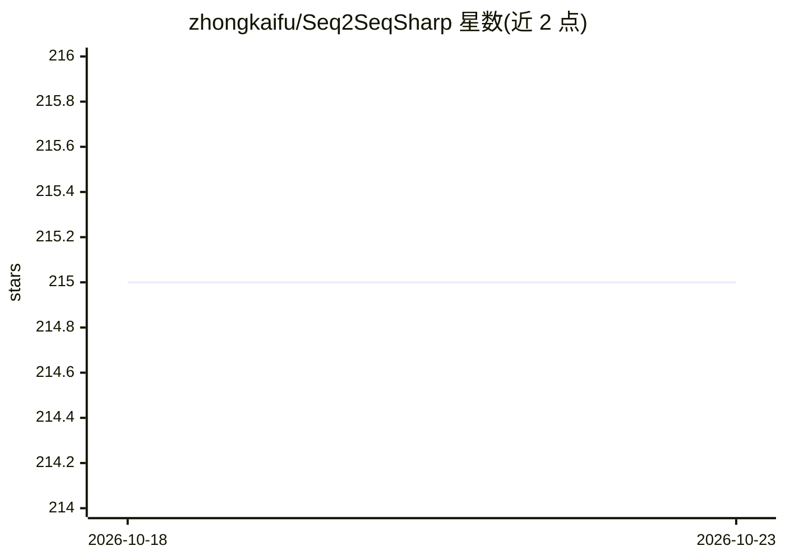

# zhongkaifu/Seq2SeqSharp

⭐ 215 · C# · NOASSERTION · 推送 2026-03-18 · [GitHub](https://github.com/zhongkaifu/Seq2SeqSharp) · 个人维护

**.NET 编写的张量式序列到序列深度神经网络框架**

纯 C# 实现的张量运算深度学习框架，面向 seq2seq（机器翻译、摘要）、序列标注、序列分类与 GPT 文本生成任务，支持文本与图像输入。提供 Transformer/LSTM/BiLSTM/GPT 解码器等网络组件、自动微分、多 GPU 并行与 FP16，跨 Windows/Linux/macOS 运行。附带 Seq2SeqConsole 等四个命令行训练测试工具及 RESTful Web API 服务，另有 Python 包。限制：CUDA 为可选后端，CPU 亦可运行。

## 筛选速览

| 维度 | 判定 | 备注 |
|---|---|---|
| AI 角色 | `ai-ecosystem` | LLM/agent 周边工具 |
| 许可风险 | `none` | NOASSERTION |
| 部署形态 | `desktop` | 安装包/桌面程序 |
| 模型依赖 | — | README 未给出锁定关系 |
| 硬件要求 | — | 无带数字的原话,不猜 |
| 安装摩擦 | `low` | 无编译、无系统依赖或容器化 |
| 成熟度 | — | 结构信号不足 |

## 能力要点

- 纯 C# 张量框架，统一 CPU/GPU 后端（CUDA、Apple Metal）
- Transformer/LSTM/BiLSTM/GPT 解码器与 MoE、FP16、多 GPU 并行
- 四个命令行工具覆盖训练/测试/验证流程
- RESTful Web API 与 Web 应用部署训练好的模型

## 适用场景

- 用命令行工具训练机器翻译或文本生成模型
- 构建序列分类、命名实体识别等任务的模型
- 通过 Web API 部署训练好的序列模型做在线推理

## 场景标签

 · 领域:深度学习/NLP

## 证据(README 行号)

> L5: Seq2SeqSharp is a high-performance, tensor-based deep neural network framework built in .NET (C#). Designed for sequ
> L43: Seq2SeqSharp offers unified tensor operations, ensuring that all tensor computations run identically on both CPUs a

## 星数曲线

2026-10-18 215 → 2026-10-23 215（+0）

---
*卡片 v1 · prompt 1.4 · 生成 2026-10-22 · 置信度 mid · 依据 README sha `f409fb16120c` · [字段定义](../../DATASET.md)*
