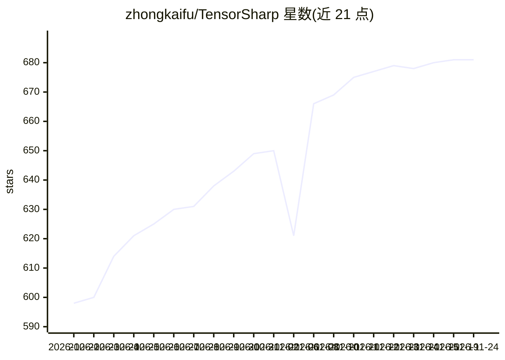

# zhongkaifu/TensorSharp

⭐ 681 · C# · BSD-3-Clause · 推送 2026-11-22 · [GitHub](https://github.com/zhongkaifu/TensorSharp) · [官网](https://tensorsharp.ai) · 个人维护 · 中文 README

**.NET 本地 GGUF 推理引擎，提供 CLI/网页/API 多种接入**

面向 .NET 开发者与本地模型使用者的 GGUF 推理引擎与 Agent 运行时：同一引擎可通过 CLI、浏览器聊天、Ollama/OpenAI 兼容 API 使用，也可嵌入自有 .NET 应用。支持文本/推理、多模态输入、嵌入、图像与视频生成、个人知识集合（BM25 默认，可选 GGUF 嵌入）以及 17 个内置 Agent 技能。服务端默认连续批处理与分页 Radix KV 缓存，可选 OpenTelemetry（默认关闭）。发布页提供自包含二进制，也可用 .NET 10 SDK 源码构建；无内置鉴权与 TLS。

## 筛选速览

| 维度 | 判定 | 备注 |
|---|---|---|
| AI 角色 | `ai-ecosystem` | LLM/agent 周边工具 |
| 许可风险 | `permissive` | BSD-3-Clause |
| 部署形态 | `desktop` | 安装包/桌面程序 |
| 模型依赖 | local-ok | 支持本地模型 |
| 硬件要求 | — | 无带数字的原话,不猜 |
| 安装摩擦 | `high` | 编译与系统依赖俱全 |
| 成熟度 | — | 结构信号不足 |

## 能力要点

- CLI、浏览器聊天与 Ollama/OpenAI 兼容 API 共用同一引擎
- 托管 C# CPU 内核与 CUDA/Metal/Vulkan 原生后端
- 17 个内置 Agent 技能，支持子代理委派与代码工具
- 支持 DeepSeek/GLM/Qwen/Gemma 等多模型家族及图像、视频、音频生成

## 适用场景

- 在 Windows/macOS/Linux 本地运行 GGUF 模型并对外提供 OpenAI 兼容 API
- 把 LLM 推理能力嵌入自己的 .NET 应用
- 在本地构建带知识集合引用与文件工具的 Agent 工作流
- 用浏览器聊天界面做多模态问答与图像/视频生成

## 场景标签

`推理引擎` `多模态` `视频生成` `聊天机器人` · 领域:对话与助手

## 证据(README 行号)

> L7: **TensorSharp is a .NET 10 inference engine for local GGUF models.** Run it on Windows, macOS or Linux through the C
> L22: - **Agent Skills and code tools.** `TensorSharp.AgentHost` adds file, shell and document workflows. The 17 bundled 

## 星数曲线

2026-10-22 598 → 2026-11-24 681（+83）

---
*卡片 v1 · prompt 1.4 · 生成 2026-11-24 · 置信度 high · 依据 README sha `57d411ea44ce` · [字段定义](../../DATASET.md)*
