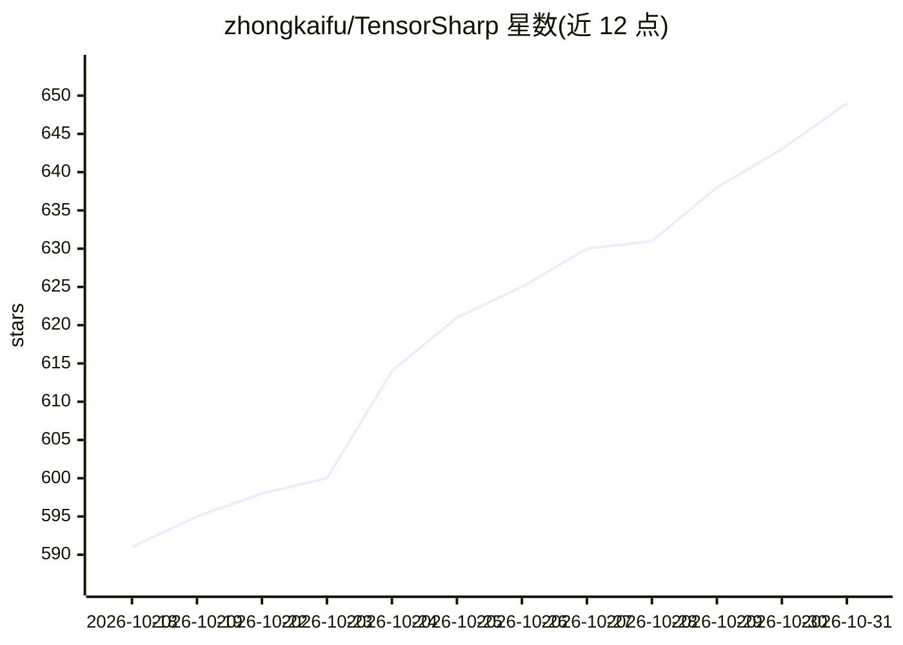

# zhongkaifu/TensorSharp

⭐ 649 · C# · BSD-3-Clause · 推送 2026-10-30 · [GitHub](https://github.com/zhongkaifu/TensorSharp) · [官网](https://tensorsharp.ai) · 个人维护 · 中文 README

**.NET 本地 GGUF 模型推理引擎与 agent 运行时**

基于 .NET 10 的本地 LLM 推理引擎：加载 GGUF 模型（含 Dense/MoE），提供 CLI、浏览器聊天、Ollama/OpenAI 兼容 HTTP API 三种使用方式，也可嵌入 .NET 应用。后端含纯 C# CPU 内核及 CUDA/Metal/Vulkan 原生加速。功能覆盖文本/多模态推理、嵌入、图像与视频生成、个人知识库（BM25 默认 + 可选 GGUF 嵌入）、AgentHost 技能与代码工具；服务端默认开启连续批处理与 Radix 前缀共享 KV 缓存。配套 TensorAgent 桌面/移动应用。限制：各模型的后端与模态支持程度不一，服务器无内置认证与 TLS。

## 筛选速览

| 维度 | 判定 | 备注 |
|---|---|---|
| AI 角色 | `ai-ecosystem` | LLM/agent 周边工具 |
| 许可风险 | `permissive` | BSD-3-Clause |
| 部署形态 | `desktop` | 安装包/桌面程序 |
| 模型依赖 | local-ok | 支持本地模型 |
| 硬件要求 | — | 无带数字的原话,不猜 |
| 安装摩擦 | `high` | 编译与系统依赖俱全 |
| 成熟度 | — | 结构信号不足 |

## 能力要点

- CLI/浏览器聊天/Ollama 与 OpenAI 兼容 API 多接口，可嵌入 .NET 应用
- 纯 C# CPU 内核与 CUDA/Metal/Vulkan 原生后端，支持多 GPU 与投机解码
- 个人知识库：文件/嵌套文件夹上传、引用定位检索、本地 BM25 默认语义可选
- AgentHost 内置 17 个技能，支持有界子代理委派与私有工作区

## 适用场景

- 在 Windows/macOS/Linux 本地运行 GGUF 模型并通过 OpenAI 兼容 API 提供服务
- 给 .NET 应用嵌入本地推理能力（文本、多模态、嵌入、图像/视频生成）
- 搭建带知识库检索与技能/代码工具的本地 agent 工作流

## 场景标签

`推理引擎` `图像生成` `视频生成` `多模态` · 领域:内容生成

## 证据(README 行号)

> L7: **TensorSharp is a .NET 10 inference engine for local GGUF models.** Run it on Windows, macOS or Linux through the C
> L20: - **Efficient serving.** Continuous batching and a paged, Radix prefix-shared KV cache are on by default. Speculati

## 星数曲线

2026-10-18 591 → 2026-10-31 649（+58）

---
*卡片 v1 · prompt 1.4 · 生成 2026-10-21 · 置信度 high · 依据 README sha `58ff8e5ad8cb` · [字段定义](../../DATASET.md)*
