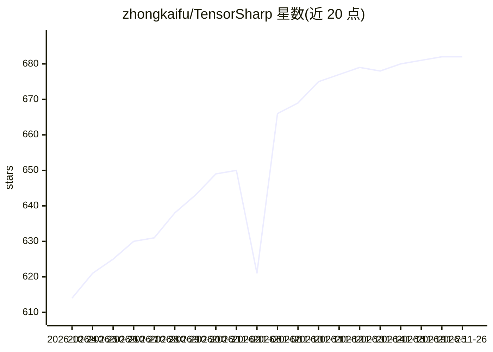

# zhongkaifu/TensorSharp

⭐ 682 · C# · BSD-3-Clause · 推送 2026-11-25 · [GitHub](https://github.com/zhongkaifu/TensorSharp) · [官网](https://tensorsharp.ai) · 个人维护 · 中文 README

**.NET 开发者的本地 GGUF 大模型推理引擎与 Agent 运行时**

面向 .NET 用户与终端使用者的本地推理引擎：读取 GGUF 模型，提供文本/推理、多模态输入、嵌入、图像与视频生成、语音识别与合成等能力。可通过 CLI、浏览器聊天、Ollama/OpenAI 兼容 HTTP API 访问，也可嵌入 .NET 应用；配套 TensorAgent 桌面与 iPhone 应用。支持 CPU（托管 C# 内核）与 CUDA/Metal/Vulkan 后端，内置持续批处理、Radix 前缀共享 KV 缓存、投机解码与多 GPU 部署，以及带文件/Shell 工具的 17 个 Agent 技能。服务器无内置认证与 TLS，需自行置于防火墙或 HTTPS 反代之后；各模型的后端与功能覆盖存在差异。

## 筛选速览

| 维度 | 判定 | 备注 |
|---|---|---|
| AI 角色 | `ai-ecosystem` | LLM/agent 周边工具 |
| 许可风险 | `permissive` | BSD-3-Clause |
| 部署形态 | `desktop` | 安装包/桌面程序 |
| 模型依赖 | local-ok | 支持本地模型 |
| 硬件要求 | — | 无带数字的原话,不猜 |
| 安装摩擦 | `high` | 编译与系统依赖俱全 |
| 成熟度 | — | 结构信号不足 |

## 能力要点

- CLI/浏览器聊天/Ollama 与 OpenAI 兼容 API 多种访问方式
- CPU、CUDA、Metal、Vulkan 多后端，支持多 GPU 与多节点
- 嵌入检索（本地 BM25 默认，可选 GGUF 语义检索）与 17 个内置 Agent 技能
- 持续批处理、Radix 前缀共享 KV 缓存与投机解码

## 适用场景

- 在 Windows/macOS/Linux 本地运行 GGUF 模型并通过 API 接入应用
- 为 .NET 应用嵌入本地大模型推理能力
- 本地管理个人知识库并对文档进行带引用的回答
- 本地生成与编辑图像、生成带音频的视频

## 场景标签

`推理引擎` `视频生成` `语音识别` `RAG` · 领域:内容生成

## 证据(README 行号)

> L7: **TensorSharp is a .NET 10 inference engine for local GGUF models.** Run it on Windows, macOS or Linux through the C
> L22: - **Agent Skills and code tools.** `TensorSharp.AgentHost` adds file, shell and document workflows. The 17 bundled 

## 星数曲线

2026-10-24 614 → 2026-11-26 682（+68）

---
*卡片 v1 · prompt 1.4 · 生成 2026-11-25 · 置信度 high · 依据 README sha `4b850b999766` · [字段定义](../../DATASET.md)*
