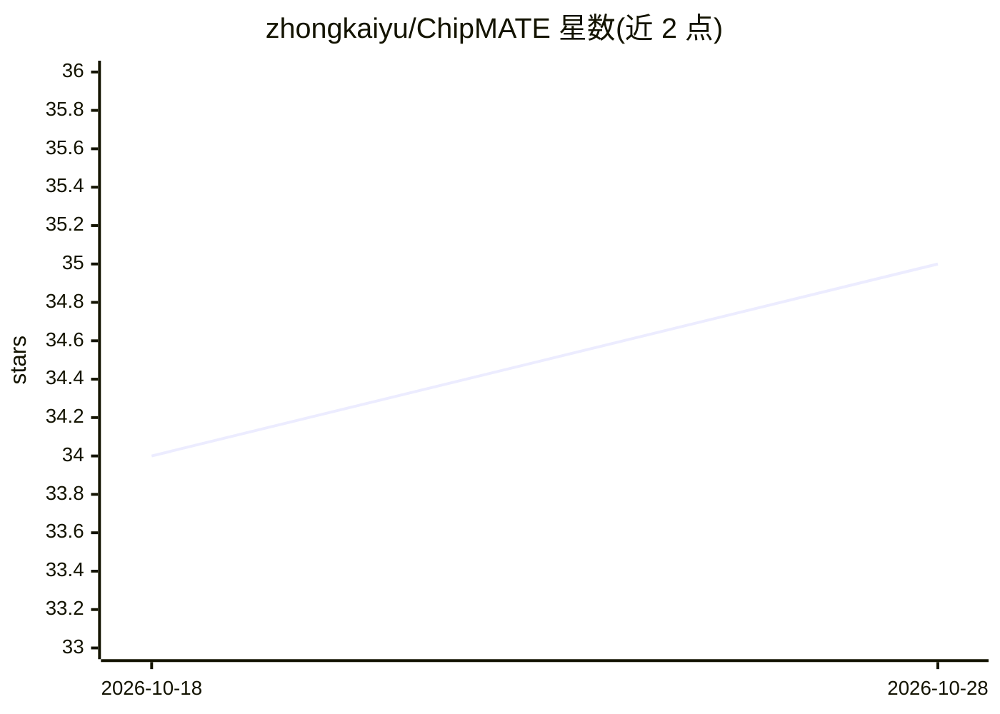

# zhongkaiyu/ChipMATE

⭐ 35 · Python · NOASSERTION · 推送 2026-07-27 · [GitHub](https://github.com/zhongkaiyu/ChipMATE) · [官网](https://chipmate.picasso-lab.com) · 组织维护

**面向 RTL 生成的多智能体推理框架，双智能体交叉验证免测试台**

论文 ChipMATE 的开源配套框架：一个 Verilog 生成智能体与一个 Python 参考模型智能体在随机激励上互相校验输出，通过交叉验证反馈迭代精炼，直到双方一致；全程不需要 golden testbench 与人工标注。提供 4B/9B 开源权重，经 vLLM 以 OpenAI 兼容端点本地部署，也可用 OpenAI/DeepSeek/Gemini/Claude 托管 API 驱动；交叉验证依赖 Icarus Verilog 编译 DUT，提供 pip 安装与内置 iverilog 的 Docker 镜像。包默认参数为快速探索设置，复现论文需显式传参。

## 筛选速览

| 维度 | 判定 | 备注 |
|---|---|---|
| AI 角色 | `ai-native` | 本体是模型或模型工具 |
| 许可风险 | `none` | NOASSERTION |
| 部署形态 | `self-host` | docker 或自建部署 |
| 模型依赖 | local-ok | 支持本地模型 |
| 硬件要求 | — | 无带数字的原话,不猜 |
| 安装摩擦 | `low` | 无编译、无系统依赖或容器化 |
| 成熟度 | — | 结构信号不足 |

## 能力要点

- Verilog 与 Python 双智能体随机激励交叉验证，无需 golden testbench
- 开源 4B/9B 权重，9B 对可用两张 GPU 部署，4B 可放入单张 24GB 显卡
- 支持 OpenAI 兼容/DeepSeek/Gemini/Anthropic 等托管 API 作为智能体后端
- 提供 CLI 批处理驱动与含 156 题的 VerilogEval V2 示例集

## 适用场景

- 从自然语言规格生成可交叉验证的 Verilog RTL 代码
- 复现论文在 VerilogEval V2/RTLLM V2 等基准上的 pass@k 结果
- 在没有 golden testbench 的工业流程中做 RTL 生成实验

## 场景标签

`多智能体` `代码生成` · 领域:Agent 开发

## 证据(README 行号)

> L3: Multi-agent inference framework for RTL code generation with LLM cross-verification.
> L8: ChipMATE pairs a **Verilog-generating agent** with a **Python reference-model agent** that mutually verify each othe
> L33: `ChipMATE-Agents-X` is the full multi-agent system you get when you run this repo — Verilog and Python agents coope

## 星数曲线

2026-10-18 34 → 2026-10-28 35（+1）

---
*卡片 v1 · prompt 1.4 · 生成 2026-10-25 · 置信度 high · 依据 README sha `ff76ef6f0fe7` · [字段定义](../../DATASET.md)*
