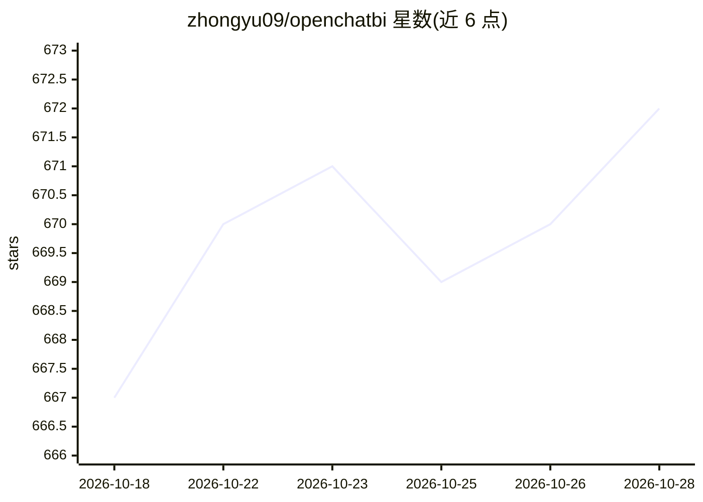

# zhongyu09/openchatbi

⭐ 672 · Python · MIT · 推送 2026-10-28 · [GitHub](https://github.com/zhongyu09/openchatbi) · [官网](https://zhongyu09.github.io/openchatbi/) · 个人维护

**对话式开源 BI 工具：用自然语言查询、分析与可视化数据**

基于 LangGraph/LangChain 构建的聊天式 BI 应用：自然语言转 SQL（含 schema linking 与 prompt 工程）、Plotly 可视化、数据目录自动发现与索引（向量或 BM25 检索）、时间序列预测、异常检测与 Adtributor 根因下钻的专门分析子代理，支持 MCP 工具接入与 LangGraph checkpointing 会话记忆。面向有数据仓库（Presto/PostgreSQL/MySQL 等）的分析与开发用户，需配置 LLM provider；提供 Streamlit/Gradio 示例 UI、CLI 与 Python API。默认 SQL 结果限行，可选 fail-closed 只读 SQL 防护，jieba 中文分词在 Python 3.12+ 回退为标点切分。

## 筛选速览

| 维度 | 判定 | 备注 |
|---|---|---|
| AI 角色 | `ai-native` | 本体是模型或模型工具 |
| 许可风险 | `permissive` | MIT |
| 部署形态 | `library` | 以包/库形式分发 |
| 模型依赖 | local-ok | 支持本地模型 |
| 硬件要求 | — | 无带数字的原话,不猜 |
| 安装摩擦 | `low` | 无编译、无系统依赖或容器化 |
| 成熟度 | — | 结构信号不足 |

## 能力要点

- text2sql 工作流：schema linking + prompt 工程生成 SQL
- 数据分析子代理编排预测、异常检测、Adtributor 下钻与 Python 执行
- 数据目录向量/BM25 检索，无嵌入模型时自动回退 BM25
- 可选 fail-closed SQL guard，仅放行 SELECT 形态查询

## 适用场景

- 用自然语言向数据仓库提问并获得图表与分析
- 做指标趋势预测、异常检测与根因下钻
- 通过对话维护表/列的业务口径与数据目录

## 场景标签

`数据分析` · 领域:效率与自动化

## 证据(README 行号)

> L3: OpenChatBI is an open source, chat-based intelligent BI tool powered by large language models, designed to help user
> L4: query, analyze, and visualize data through natural language conversations. Built on LangGraph and LangChain ecosyste
> L14: 2. **Automatic SQL Generation**: Convert natural language queries into SQL statements using advanced text2sql workf

## 星数曲线

2026-10-18 667 → 2026-10-28 672（+5）

---
*卡片 v1 · prompt 1.4 · 生成 2026-10-21 · 置信度 high · 依据 README sha `ae70148a5638` · [字段定义](../../DATASET.md)*
