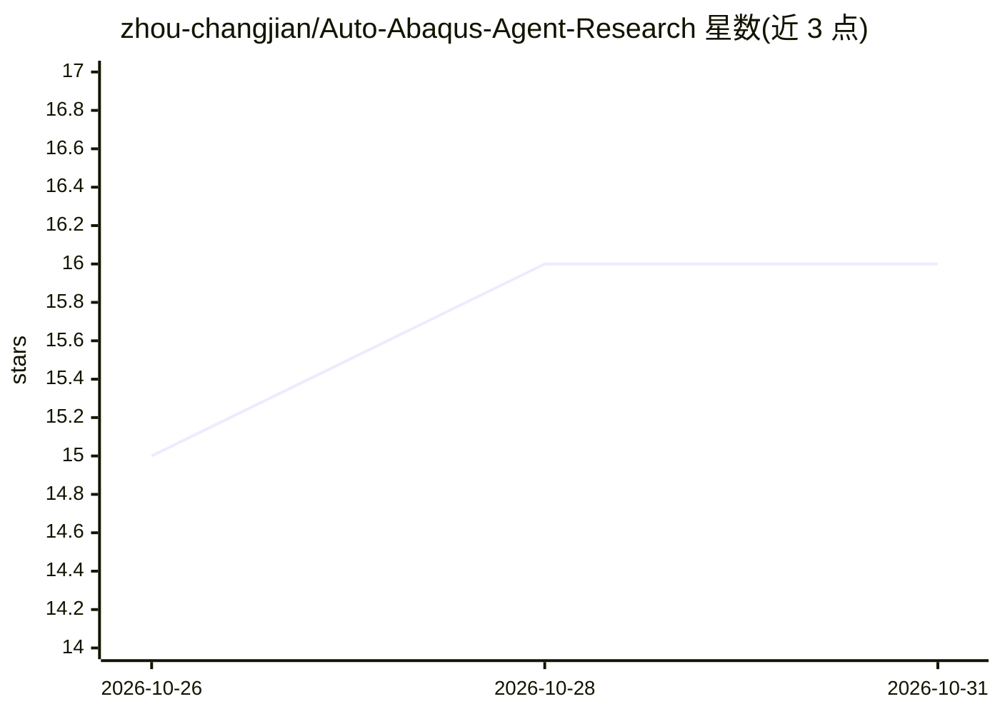

# zhou-changjian/Auto-Abaqus-Agent-Research

⭐ 16 · Python · MIT · 推送 2026-04-18 · [GitHub](https://github.com/zhou-changjian/Auto-Abaqus-Agent-Research) · 个人维护 · 中文 README

**面向 Abaqus 有限元分析的自主 ReAct AI 智能体**

AAAR 是专为 Abaqus 有限元分析设计的自主式 AI Agent：以 ReAct 循环自主规划并调用 10+ 专业工具，包括收敛诊断（匹配 200+ 已知错误模式）、网格质量分析、自然语言生成 INP/Python 脚本、输出解析等；提供三面板 Web IDE（React 前端 + FastAPI 后端）与纯 CLI 两种形态。支持 OpenAI、Claude、DeepSeek、Qwen、Ollama 等 15+ LLM 供应商，Docker 内的 Agent 可通过宿主机桥接调用 Windows 上的 Abaqus 命令。需 Python 3.10+，MIT 许可。

## 筛选速览

| 维度 | 判定 | 备注 |
|---|---|---|
| AI 角色 | `ai-native` | 本体是模型或模型工具 |
| 许可风险 | `permissive` | MIT |
| 部署形态 | `self-host` | docker 或自建部署 |
| 模型依赖 | local-ok | 支持本地模型 |
| 硬件要求 | — | 无带数字的原话,不猜 |
| 安装摩擦 | `low` | 无编译、无系统依赖或容器化 |
| 成熟度 | — | 结构信号不足 |

## 能力要点

- ReAct Agent 自主规划与调用 10+ 专业 Abaqus 分析工具
- 收敛诊断匹配 200+ 已知错误模式并给出修复方案
- 自然语言生成 .inp 文件或 Python 脚本，覆盖 9 大工程领域
- Docker 容器经宿主机桥接安全调用 Windows 上的 Abaqus 命令

## 适用场景

- 让 AI 诊断我的 Abaqus 作业为什么不收敛并给出修复方案
- 用自然语言描述工况直接生成 INP 文件
- 在 Web IDE 里边看文件边与 Agent 对话完成分析

## 场景标签

`代码生成` · 领域:编码与开发

## 证据(README 行号)

> L16: AAAR (Auto Abaqus Agent Research) 是一个**自主式 AI 智能体**，专为 Abaqus 有限元分析设计。它不是简单的 LLM 聊天包装器——而是一个能够**自主思考、主动探索、调用专业工具**的
> L22: - 🔧 **10+ 专业工具** — 收敛诊断、网格分析、INP 生成、输出解析，一键调用

## 星数曲线

2026-10-26 15 → 2026-10-31 16（+1）

---
*卡片 v1 · prompt 1.4 · 生成 2026-10-30 · 置信度 mid · 依据 README sha `c610d74b5762` · [字段定义](../../DATASET.md)*
