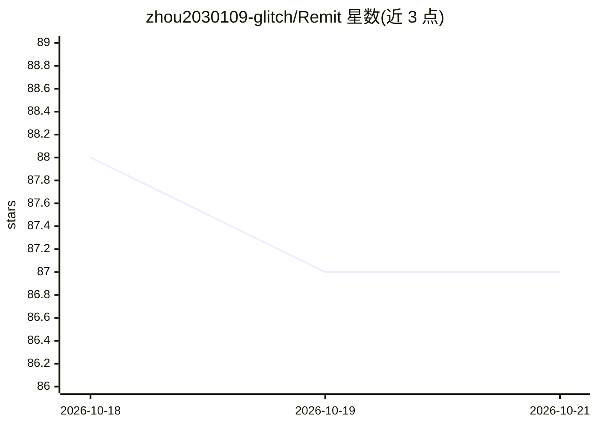

# zhou2030109-glitch/Remit

⭐ — · [GitHub]() · 个人维护 · 中文 README

**多智能体协作的数学建模 AI 桌面工作台**

本地优先的数学建模工作台：协调手、建模手、代码手、论文手四个 Agent 通过团队对话协作，完成题意分析、探索实验、代码执行（MATLAB 可选或回退 Python）与论文写作，支持人工审核、断点恢复、LaTeX 编辑与 PDF 导出。用户自带模型 API 服务，配置与任务数据保存在本机。提供 Docker Compose 与源码两种运行方式，Windows/macOS 原生安装包由 CI 构建生成；项目自述处于持续开发中，不保证赛题求解正确或比赛格式合规。

## 筛选速览

| 维度 | 判定 | 备注 |
|---|---|---|
| AI 角色 | `ai-native` | 本体是模型或模型工具 |
| 许可风险 | `permissive` | — |
| 部署形态 | `self-host` | docker 或自建部署 |
| 模型依赖 | — | README 未给出锁定关系 |
| 硬件要求 | — | 无带数字的原话,不猜 |
| 安装摩擦 | `low` | 无编译、无系统依赖或容器化 |
| 成熟度 | `idea` | |

## 能力要点

- 四个角色 Agent 分工协作，方案与成果由用户确认
- 按小问执行探索实验，保留检查点并支持断点恢复
- 论文工作区支持章节续写、LaTeX 编辑与 PDF 预览
- 计算后端 MATLAB 优先、不可用时回退 Python（MATLAB 可选）

## 适用场景

- 数学建模竞赛中让 Agent 队伍完成读题、建模、计算与论文写作
- 按小问开展探索实验并复用已校验的中间结果
- 在本地编辑、编译并导出符合排版规则的 LaTeX 论文

## 场景标签

`多智能体` `AI 写作` · 领域:Agent 开发

## 证据(README 行号)

> L3:  多 Agent 协作的数学建模 AI 工作台
> L25: 本地数学建模工作台：通过团队对话，让协调手、建模手、代码手和论文手协作完成题目分析、计算与论文写作。
> L37: 团团协调计划，灵灵负责建模，点点运行计算，墨墨整理为论文。题意、方案与最终成果由你确认。

## 星数曲线

2026-10-18 88 → 2026-10-21 87（-1）

---
*卡片 v1 · prompt 1.4 · 生成 2026-10-18 · 置信度 high · 依据 README sha `37f27bd43974` · [字段定义](../../DATASET.md)*
