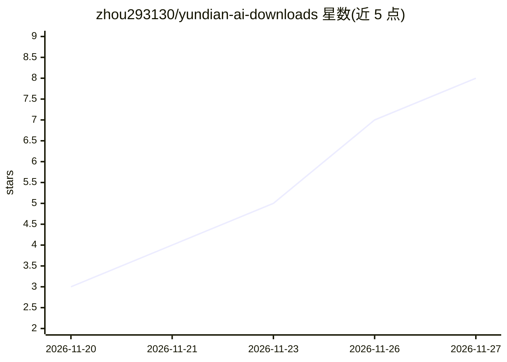

# zhou293130/yundian-ai-downloads

⭐ 8 · 推送 2026-11-15 · [GitHub](https://github.com/zhou293130/yundian-ai-downloads) · [官网](https://www.ai-yundian.com/) · 组织维护 · 中文 README

**面向电商商家的 Windows 自动化工作台：AI 生图与批量上架**

云店AI 是一款面向电商商家的 Windows 专有软件，把商品素材处理与店铺操作整合在一个工作台：批量生成商品标题、主图、白底图、详情页与带货短视频，并执行淘宝/天猫/抖店的批量上架、商品批量编辑、搜推素材上传与货源铺货。云店 Agent 支持自然语言交代任务并在授权范围内调用云店工具，另支持 MCP 供外部 Agent 调用上架、编辑、素材和运营工具。软件从官网百度网盘或 GitHub 发布页下载，每期可领 30 天 0 元免费版，额度以账号中心显示为准。

## 筛选速览

| 维度 | 判定 | 备注 |
|---|---|---|
| AI 角色 | `ai-enhanced` | 去掉 AI 部分产品仍成立 |
| 许可风险 | `none` | — |
| 部署形态 | `None` |  |
| 模型依赖 | — | README 未给出锁定关系 |
| 硬件要求 | — | 无带数字的原话,不猜 |
| 安装摩擦 | `low` | 无编译、无系统依赖或容器化 |
| 成熟度 | — | 结构信号不足 |

## 能力要点

- AI 批量生成商品主图、白底图、模特试衣图与整套详情页
- 电商口播与带货短视频批量混剪，自动配字幕、封面和配乐
- 淘宝、天猫、抖店自动批量上架与商品批量编辑
- 云店 Agent 自然语言任务执行，并提供 MCP 接口供外部 Agent 调用工具

## 适用场景

- 批量生成商品主图、白底图和详情页素材
- 把本地素材批量上新到淘宝、天猫或抖店
- 按商品目录批量混剪带货短视频并发布
- 用 Agent 整理商品资料、做 SKU 表和运营文案

## 场景标签

`AI 写作` `视频生成` `图像生成` · 领域:内容生成

## 证据(README 行号)

> L5: 云店AI（Yundian AI）是面向电商商家的 Windows 软件。从**找货源、整理素材**，到**生成商品标题、主图、详情页和短视频**，再到**批量上架、修改已有商品和做店铺运营**，都可以在一个工作台按批处理。云店 Ag
> L87: - **云店 Agent。** 用自然语言交代整理商品资料、提炼卖点、做表格、写运营文案等工作。它可以检查素材，在授权范围内调用云店工具、查看任务进度和排查报错。
> L104: 云店AI是专有软件，软件使用遵循安装时显示的许可条款。

## 星数曲线

2026-11-20 3 → 2026-11-27 8（+5）

---
*卡片 v1 · prompt 1.4 · 生成 2026-11-21 · 置信度 high · 依据 README sha `901e713375b5` · [字段定义](../../DATASET.md)*
