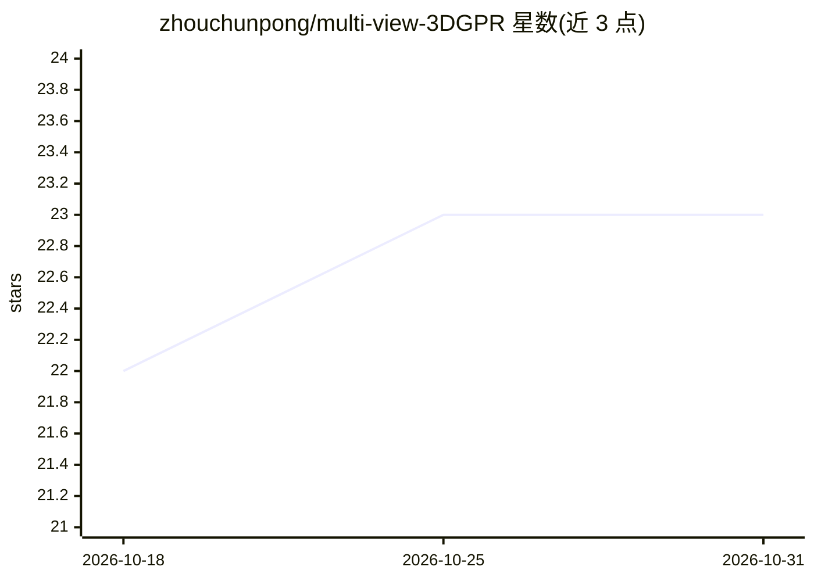

# zhouchunpong/multi-view-3DGPR

⭐ 23 · Python · GPL-3.0 · 推送 2026-09-18 · [GitHub](https://github.com/zhouchunpong/multi-view-3DGPR) · [官网](https://arxiv.org/abs/2308.04779) · 个人维护

**3D 探地雷达路基病害检测的多视图融合蒸馏框架与数据集**

论文《Multi-View Fusion and Distillation for Subgrade Distresses Detection based on 3D-GPR》的参考代码与数据集。方法利用原生 3D-GPR 数据构建多视图图像数据集，相比 A-scan/B-scan 提供更丰富空间信息，相比 C-scan 降低计算复杂度；提出 GPR-MVFD 框架，结合注意力融合与多视图蒸馏，并采用自适应学习机制稳定训练。数据集经 Google Drive 链接提供下载，训练与测试分别通过 Python 脚本运行，依赖 Python 3.7、PyTorch 1.11.0 与 CUDA 11.3。

## 筛选速览

| 维度 | 判定 | 备注 |
|---|---|---|
| AI 角色 | `ai-native` | 本体是模型或模型工具 |
| 许可风险 | `viral` | GPL-3.0 |
| 部署形态 | `None` |  |
| 模型依赖 | — | README 未给出锁定关系 |
| 硬件要求 | — | 无带数字的原话,不猜 |
| 安装摩擦 | `medium` | 含编译或系统依赖之一 |
| 成熟度 | — | 结构信号不足 |

## 能力要点

- 基于原生 3D-GPR 数据构建的多视图图像数据集
- GPR-MVFD 框架：注意力融合 + 多视图蒸馏 + 自适应学习机制
- 提供训练与评估脚本（train/test_DenseNet121_MVFD.py）
- 数据集通过 Google Drive 链接提供下载

## 适用场景

- 复现论文中的路基病害检测方法
- 使用多视图 GPR 数据集做检测研究
- 作为多视图学习/知识蒸馏方法的实验基线

## 场景标签

`目标检测` · 领域:感知与多模态

## 证据(README 行号)

> L12: The 3D ground-penetrating radar (3D-GPR) has been widely used for the subgrade distress detection. To enhance the e
> L13: based fusion and multi-view distillation to facilitate significant feature extraction for subgrade distresses. In a

## 星数曲线

2026-10-18 22 → 2026-10-31 23（+1）

---
*卡片 v1 · prompt 1.4 · 生成 2026-10-27 · 置信度 high · 依据 README sha `3c5a635cb328` · [字段定义](../../DATASET.md)*
