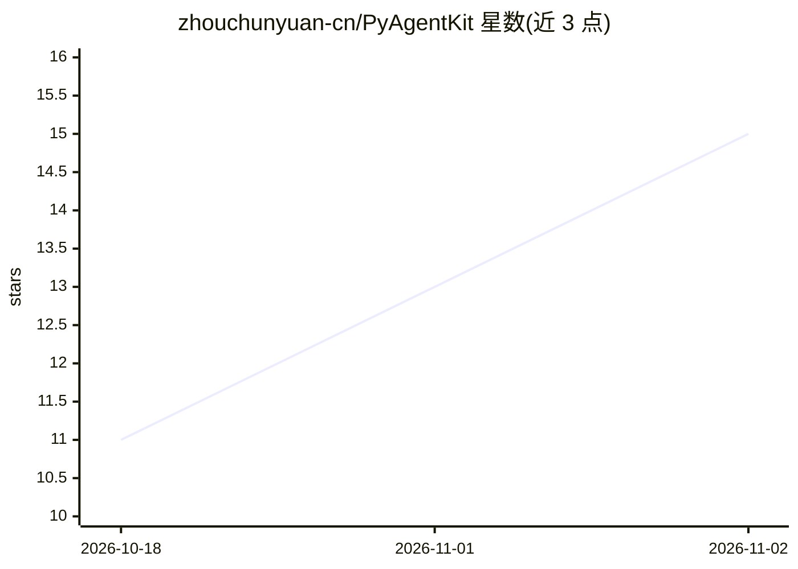

# zhouchunyuan-cn/PyAgentKit

⭐ 15 · Python · MIT · 推送 2026-10-24 · [GitHub](https://github.com/zhouchunyuan-cn/PyAgentKit) · [官网](https://github.com/zhouchunyuan-cn/PyAgentKit/blob/main/docs/README.md) · 个人维护 · 中文 README

**可通读的教学型 AI Agent 框架：7000 行源码配 9 章中文教程**

面向想理解 Agent 框架原理的开发者：用约 7000 行 Python 实现完整功能集——ReAct 推理循环、Sequential/Hierarchical 多智能体协作、官方协议 MCP 客户端（HTTP/stdio 双传输）、文件检查点断点续跑、流式输出、Token 统计与 Trace，配 426 个单元测试与 9 章中文教程。LLM 抽象层支持智谱 GLM 原生客户端与任意 OpenAI 兼容端点（DeepSeek/vLLM/Ollama 零新增依赖切换）。定位为教学取舍：单机单进程、文件存储，README 明确指出生产部署应选工业级框架。通过 git clone 后 pip install -e 安装，提供 pyagentkit CLI 与 YAML 声明式编排。

## 筛选速览

| 维度 | 判定 | 备注 |
|---|---|---|
| AI 角色 | `ai-ecosystem` | LLM/agent 周边工具 |
| 许可风险 | `permissive` | MIT |
| 部署形态 | `library` | 以包/库形式分发 |
| 模型依赖 | local-ok | 支持本地模型 |
| 硬件要求 | — | 无带数字的原话,不猜 |
| 安装摩擦 | `low` | 无编译、无系统依赖或容器化 |
| 成熟度 | — | 结构信号不足 |

## 能力要点

- 核心约 7000 行源码可一个下午通读，配 9 章中文教程
- ReAct 循环 + Sequential/Hierarchical 多智能体团队 + Leader 自动编排
- 官方协议 MCP 客户端（Streamable HTTP 与 stdio 双传输）
- 断点续跑：每步原子落盘，同 run_id 从断点继续不重复调用 LLM

## 适用场景

- 通读一份完整 Agent 框架源码来理解 ReAct、多智能体、MCP 等原理
- 借鉴小体量架构设计来搭建自己的 Agent 系统
- 用 YAML 声明多 Agent 团队并配合 GLM/OpenAI 兼容端点运行实验

## 场景标签

`Agent 框架` `多智能体` `教程课程` · 领域:Agent 开发

## 证据(README 行号)

> L12: PyAgentKit 是中间那条路：一个**完整形态**的 AI Agent 框架——ReAct 推理、多智能体协作、
> L53: |🔌 **LLM 抽象层**|GLM 原生 + OpenAI 兼容双实现（DeepSeek/vLLM/Ollama 即插即用）；重试、Key 校验内置|
> L29: > 想直接部署生产业务 → 请用工业级框架（单机单进程、文件存储是明确的教学取舍）。

## 星数曲线

2026-10-18 11 → 2026-11-02 15（+4）

---
*卡片 v1 · prompt 1.4 · 生成 2026-10-31 · 置信度 high · 依据 README sha `a7792f46e13a` · [字段定义](../../DATASET.md)*
