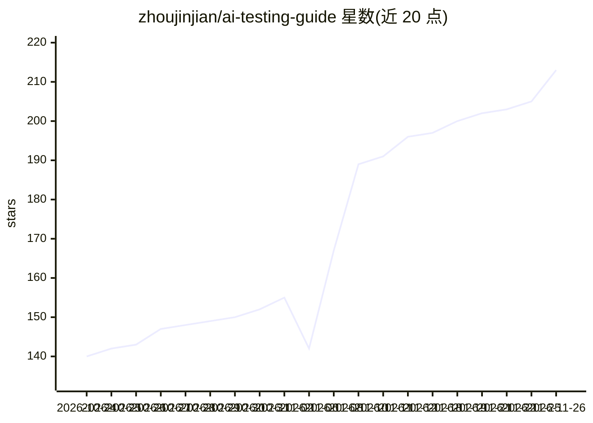

# zhoujinjian/ai-testing-guide

⭐ 213 · NOASSERTION · 推送 2026-10-28 · [GitHub](https://github.com/zhoujinjian/ai-testing-guide) · [官网](https://ai.testfather.cn/) · 个人维护 · 中文 README

**测试工程师的 AI 测试开发学习路线与资源导航**

以学习路线图组织的测试开发知识仓库，覆盖从计算机基础、编程语言到接口/UI 自动化、性能测试、CI/CD 等阶段，并设 AI 辅助测试与大模型评测两章（Dify 搭建、评测集、RAG/Agent 评测、LLM-as-a-Judge）。面向在校学生、功能测试转型者与在职测试工程师，按背景提供定制路径；配套面试题库、工具书单资源、在线导航站与社区渠道。文档采用 CC BY-NC-SA 4.0，示例代码采用 MIT 协议，持续更新中。

## 筛选速览

| 维度 | 判定 | 备注 |
|---|---|---|
| AI 角色 | `ai-knowledge` | 知识聚合/清单类 |
| 许可风险 | `none` | NOASSERTION |
| 部署形态 | `None` |  |
| 模型依赖 | — | README 未给出锁定关系 |
| 硬件要求 | — | 无带数字的原话,不猜 |
| 安装摩擦 | `low` | 无编译、无系统依赖或容器化 |
| 成熟度 | — | 结构信号不足 |

## 能力要点

- 13 章学习路线，含 AI 辅助测试与 AI 应用评测两个 AI 章节
- 按功能测试转测开/后端转测开/校招零基础提供定制路径
- 配套 200 题分类面试题库、140 个测试工具与 66 份书单
- 文档 CC BY-NC-SA 4.0，示例代码 MIT 协议

## 适用场景

- 零基础规划从功能测试到测试开发的求职路径
- 想把 AI 提效融入测试用例设计与自动化脚本编写
- 切入 RAG/Agent/大模型应用评测方向的学习
- 准备测试开发岗位的分类面试题练习

## 场景标签

`教程课程` `模型评测` · 领域:评测与运维

## 证据(README 行号)

> L13: 软件测试开发正在被 AI 重塑：用例可以让 AI 出初稿，脚本可以让 AI 帮忙写，但「判断测得够不够、质量有没有滑坡、问题出在哪一层」仍然需要人。这个仓库整理了一条从零基础到测试开发工程师（SDET）的完整学习路线：既打牢传统测
> L43: |阶段十|11 AI 应用测试与大模型评测|✨ 婴变圆满|Dify 知识库 / Workflow 搭建 · 评测集建设 · RAG / Agent / 安全评测 · LLM-as-a-Judge · 上线门禁与 bad case 
> L61: |docs/interview|持续更新|分类面试题库：大模型测试 + 软件测试必备 + 自动化测试 + 性能测试 + 安全测试 + AI 测试提效 + 研发效能度量 + 测试平台开发 + 测试管理 + 测试流程与团队协作共 20

## 星数曲线

2026-10-24 140 → 2026-11-26 213（+73）

---
*卡片 v1 · prompt 1.4 · 生成 2026-11-25 · 置信度 high · 依据 README sha `85d590bc8219` · [字段定义](../../DATASET.md)*
