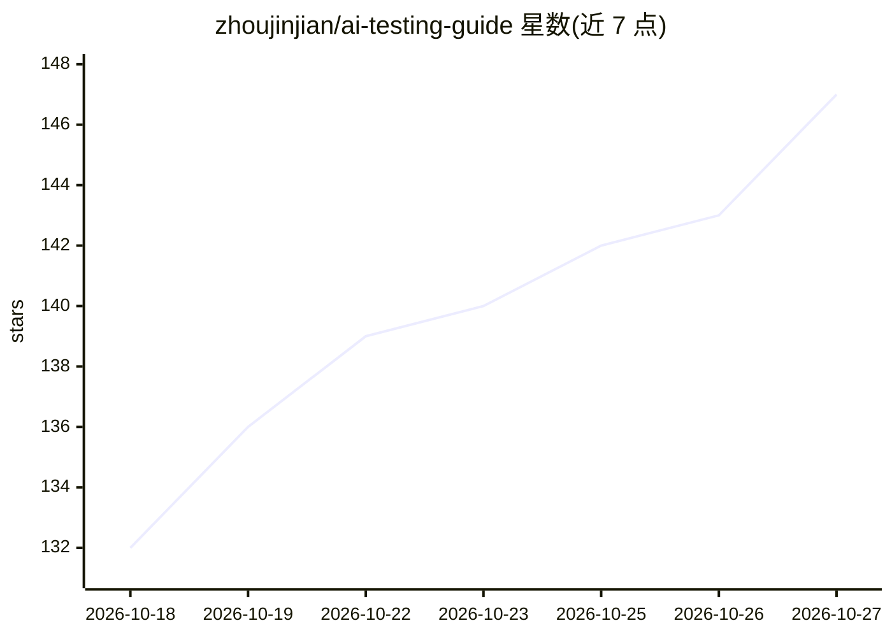

# zhoujinjian/ai-testing-guide

⭐ 147 · NOASSERTION · 推送 2026-10-23 · [GitHub](https://github.com/zhoujinjian/ai-testing-guide) · [官网](https://ai.testfather.cn/) · 个人维护 · 中文 README

**测试工程师的 AI 时代学习路线与面试资源合集**

面向测试开发方向（SDET）的中文学习路线仓库：从零基础到测试开发工程师分 13 章 11 个阶段组织，覆盖编程基础、测试理论、接口/UI 自动化、性能测试、CI/CD 与质量平台，以及 AI 辅助测试和 AI 应用评测两章；配套实战教程 20 篇、200 题分类面试题库、140 个测试工具与 66 份书单导航。每章末尾附自查清单，路线总览为不同背景提供三条定制路径。文档以 CC BY-NC-SA 4.0 发布，示例代码 MIT。

## 筛选速览

| 维度 | 判定 | 备注 |
|---|---|---|
| AI 角色 | `ai-knowledge` | 知识聚合/清单类 |
| 许可风险 | `none` | NOASSERTION |
| 部署形态 | `None` |  |
| 模型依赖 | — | README 未给出锁定关系 |
| 硬件要求 | — | 无带数字的原话,不猜 |
| 安装摩擦 | `low` | 无编译、无系统依赖或容器化 |
| 成熟度 | — | 结构信号不足 |

## 能力要点

- 13 章 11 阶段学习路线，含 AI 辅助测试与 AI 应用评测两章
- 分类面试题库 200 题与资源导航（140 个工具、66 份书单）
- 每章末尾自查清单与按背景定制的三条路径
- 配套在线导航站提供进度跟踪、面试刷题与简历模板

## 适用场景

- 功能测试或后端工程师按定制路线转型测试开发
- 学习用 AI 生成用例、脚本与切入 RAG/Agent 评测
- 测开求职时刷分类面试题与准备项目叙事

## 场景标签

`教程课程` `精选清单` · 领域:学习与行业

## 证据(README 行号)

> L13: 软件测试开发正在被 AI 重塑：用例可以让 AI 出初稿，脚本可以让 AI 帮忙写，但「判断测得够不够、质量有没有滑坡、问题出在哪一层」仍然需要人。这个仓库整理了一条从零基础到测试开发工程师（SDET）的完整学习路线：既打牢传统测
> L42: |阶段九|10 AI 辅助测试|🦋 婴变初期|AI 编程提效 · 提示词工程 · AI 生成用例与脚本 · AI 代码审查与失败归因 · MCP / Skill|
> L43: |阶段十|11 AI 应用测试与大模型评测|✨ 婴变圆满|Dify 知识库 / Workflow 搭建 · 评测集建设 · RAG / Agent / 安全评测 · LLM-as-a-Judge · 上线门禁与 bad case 

## 星数曲线

2026-10-18 132 → 2026-10-27 147（+15）

---
*卡片 v1 · prompt 1.4 · 生成 2026-10-22 · 置信度 high · 依据 README sha `459360aec2a3` · [字段定义](../../DATASET.md)*
