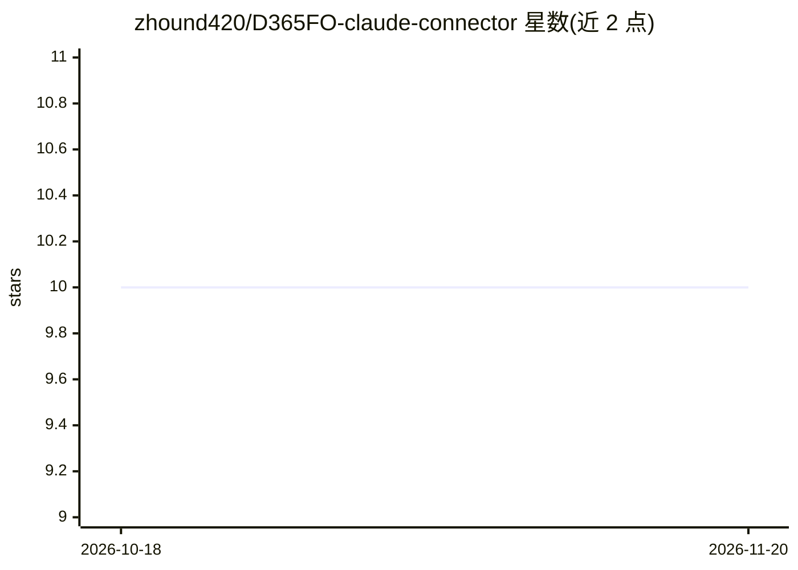

# zhound420/D365FO-claude-connector

⭐ 10 · TypeScript · MIT · 推送 2026-03-15 · [GitHub](https://github.com/zhound420/D365FO-claude-connector) · 个人维护

**让 Claude 等 AI 助手访问 Dynamics 365 F&O 数据的 MCP 服务器**

基于 MCP 协议的服务器，将 Microsoft Dynamics 365 Finance & Operations 环境接入 Claude Desktop / Claude Code 等 AI 助手：提供 22 个工具（OData 查询、聚合、跨实体 join、批量操作、时段对比、时间序列、客户分析）与元数据发现资源，写操作仅在非生产环境开放，生产环境设计为只读。通过 Azure AD 客户端凭据认证，支持多环境配置、24 小时元数据缓存与环境仪表盘，经 npm 安装或源码构建，附交互式配置向导。

## 筛选速览

| 维度 | 判定 | 备注 |
|---|---|---|
| AI 角色 | `ai-ecosystem` | LLM/agent 周边工具 |
| 许可风险 | `permissive` | MIT |
| 部署形态 | `library` | 以包/库形式分发 |
| 模型依赖 | locked-api |  |
| 硬件要求 | — | 无带数字的原话,不猜 |
| 安装摩擦 | `low` | 无编译、无系统依赖或容器化 |
| 成熟度 | — | 结构信号不足 |

## 能力要点

- 22 个专用工具覆盖查询、聚合、批量 CRUD 与分析
- 生产环境强制只读，写操作仅限非生产环境
- 支持多环境配置与按环境切换的 MCP 资源/工具
- 提供 Claude Desktop / Claude Code 的配置向导

## 适用场景

- 用自然语言查询和聚合 D365 F&O 业务数据
- 在非生产环境由 AI 助手代为创建/更新/删除记录
- 对销售数据做同比环比与趋势分析
- 比较不同 D365 环境间的实体 schema 差异

## 场景标签

`数据分析` · 领域:效率与自动化

## 证据(README 行号)

> L3: An MCP (Model Context Protocol) server that provides access to Microsoft Dynamics 365 Finance & Operations environme
> L10: - **MCP Resources** for schema discovery and metadata exploration

## 星数曲线

2026-10-18 10 → 2026-11-20 10（+0）

---
*卡片 v1 · prompt 1.4 · 生成 2026-11-19 · 置信度 high · 依据 README sha `74d2159632c7` · [字段定义](../../DATASET.md)*
