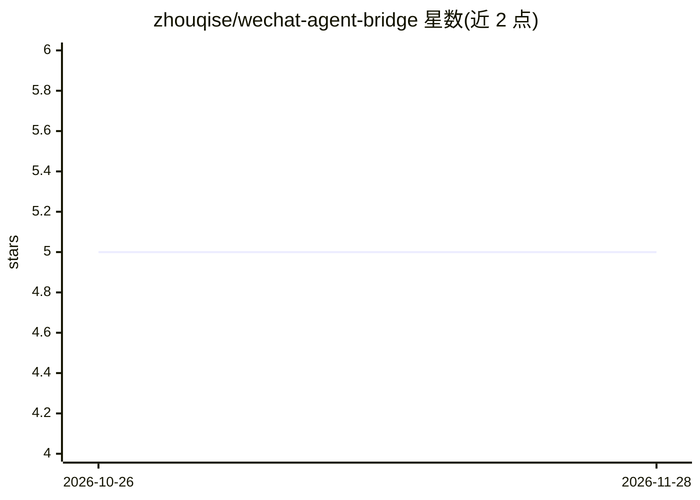

# zhouqise/wechat-agent-bridge

⭐ 5 · JavaScript · MIT · 推送 2026-10-19 · [GitHub](https://github.com/zhouqise/wechat-agent-bridge) · [官网](https://github.com/zhouqise/wechat-agent-bridge/releases/latest) · 个人维护 · 中文 README

**多微信用户扫码共用本机 Codex/Claude Code 的桥接工具**

基于 Node.js 的本机桥接服务：多人各自微信扫码绑定后，分别向本机已安装的 Codex CLI / Claude Code 提交任务，支持按用户隔离的工作区、任务队列、会话与单次审批。提供浏览器管理面板管理用户启停、认证与模型配置；按需扩展截图、PDF/Office、OCR、MP4 视频分析与网页正文提取能力。需 Node.js 22+ 与至少一个已认证引擎，安装包经 GitHub Releases 提供，尚未发布到 npm。

## 筛选速览

| 维度 | 判定 | 备注 |
|---|---|---|
| AI 角色 | `ai-ecosystem` | LLM/agent 周边工具 |
| 许可风险 | `permissive` | MIT |
| 部署形态 | `library` | 以包/库形式分发 |
| 模型依赖 | — | README 未给出锁定关系 |
| 硬件要求 | — | 无带数字的原话,不猜 |
| 安装摩擦 | `medium` | 含编译或系统依赖之一 |
| 成熟度 | — | 结构信号不足 |

## 能力要点

- 多用户扫码并行使用本机 Codex / Claude Code，工作区与队列按用户隔离
- 浏览器管理面板：用户启停、引擎切换、模型与认证配置、实时日志
- 微信内任务队列、会话切换、连续消息合并与单次授权审批
- 可选媒体能力：截图、PDF/Office 解析、本地中英文 OCR、MP4 抽帧与音轨转写

## 适用场景

- 家人或协作者各自用微信共用一台电脑上的编码 agent
- 在微信中远程给本机 AI 任务发指令并审批授权操作
- 通过微信发送 PDF、截图、视频等文件让 agent 分析并自动回传结果

## 场景标签

`编码 Agent` `OCR` · 领域:编码与开发

## 证据(README 行号)

> L53: |**双引擎与模型切换**|微信切换 Codex / Claude Code；支持本机登录、API Key、自定义接口和模型设置|
> L65: 准备 **Node.js 22+、npm、系统 curl**，以及至少一种已安装并完成认证配置的引擎：Codex CLI 或 Claude Code。
> L87: 安装包通过 GitHub Releases 提供，尚未发布到 npm。全局目录权限、引擎安装及代理配置见完整安装指南。

## 星数曲线

2026-10-26 5 → 2026-11-28 5（+0）

---
*卡片 v1 · prompt 1.4 · 生成 2026-11-20 · 置信度 mid · 依据 README sha `55360ca864e4` · [字段定义](../../DATASET.md)*
