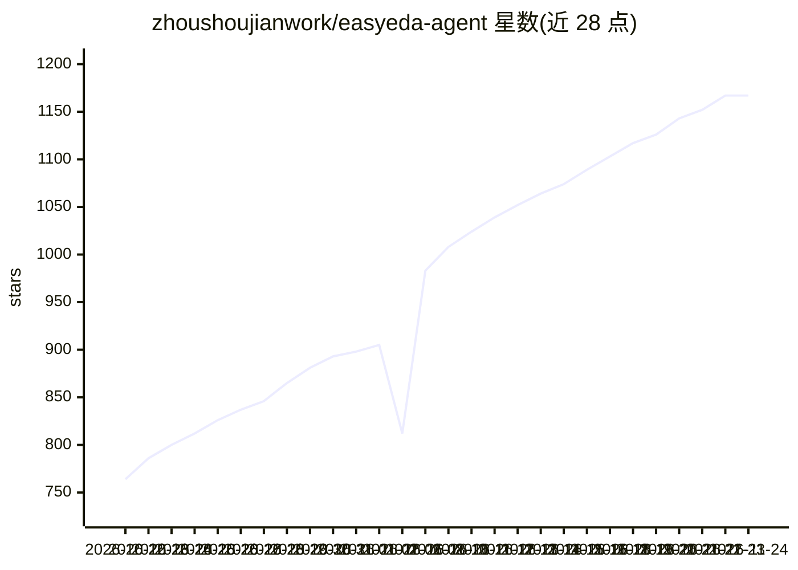

# zhoushoujianwork/easyeda-agent

⭐ 1,167 · Go · NOASSERTION · 推送 2026-11-22 · [GitHub](https://github.com/zhoushoujianwork/easyeda-agent) · [官网](https://eda.daboluo.cc) · 个人维护 · 中文 README

**EasyEDA Pro 的 AI 自动化工具：生成原理图与 PCB**

easyeda-agent 是嘉立创 EDA 专业版的 AI 自动化层：用户用自然语言描述电路需求，Agent 读取真实工程数据，通过官方 eda.* API 完成 Symbol/Footprint 建库、原理图整理、PCB 布局布线、丝印调整与 DRC/DFM 检查，并在写入前后做器件身份与几何校验。以 CLI/daemon、EasyEDA 内连接器与 AI 客户端 Skill 三部分组成，要求 EasyEDA Pro V4。配套的 EdaDesk Desktop 为独立专有软件，本仓库仅发布其安装包与反馈。

## 筛选速览

| 维度 | 判定 | 备注 |
|---|---|---|
| AI 角色 | `ai-native` | 本体是模型或模型工具 |
| 许可风险 | `none` | NOASSERTION |
| 部署形态 | `None` |  |
| 模型依赖 | — | README 未给出锁定关系 |
| 硬件要求 | — | 无带数字的原话,不猜 |
| 安装摩擦 | `low` | 无编译、无系统依赖或容器化 |
| 成熟度 | — | 结构信号不足 |

## 能力要点

- 从 PDF 数据手册读取证据自动建库并校验 pin↔pad 映射
- 自然语言需求到选型、原理图、布局布线、铺铜、DRC 的完整流程
- 写入前检查、写入后回读对账的工作流机制
- 提供 CLI、Agent Skill 与 MCP 三种接入方式

## 适用场景

- 根据芯片数据手册 PDF 快速创建器件库
- 从需求文档生成 ESP32 等最小系统板到 DRC 完成
- 批量标准化已有原理图中的非标准器件
- 检查并修复现有工程的连接、几何与 DRC 问题

## 场景标签

 · 领域:电子设计自动化/硬件设计

## 证据(README 行号)

> L17: `easyeda-agent` 是 EasyEDA Pro（嘉立创 EDA 专业版）的 AI 自动化层。你可以直接描述想做的
> L58: |**从需求做到一块板**|从自然语言需求完成选型、原理图、分区布局、PCB、板框、叠层、布线、铺铜、丝印、DRC 和制造检查|

## 星数曲线

2026-10-22 764 → 2026-11-24 1,167（+403）

---
*卡片 v1 · prompt 1.4 · 生成 2026-11-23 · 置信度 high · 依据 README sha `437fb4921aae` · [字段定义](../../DATASET.md)*
