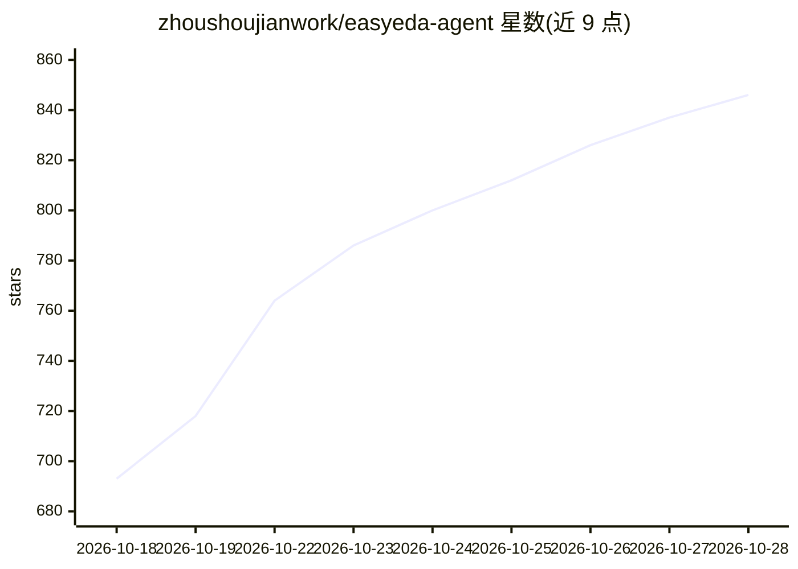

# zhoushoujianwork/easyeda-agent

⭐ 846 · Go · NOASSERTION · 推送 2026-10-25 · [GitHub](https://github.com/zhoushoujianwork/easyeda-agent) · [官网](https://jlc-ext.com/item/zhoushoujian/easyeda-agent-connector) · 个人维护 · 中文 README

**让 AI Agent 直接操作嘉立创 EDA 专业版的自动化层**

EasyEDA Pro 的 AI 自动化工具：把原理图/PCB 操作封装为 typed actions，通过 CLI/daemon、运行在 EDA 内的 Connector 和 Agent Skill 三部分组成，支持 stdio MCP 接入。Agent 可读取真实工程数据，经官方 eda.* API 完成建库、原理图、布局布线、铺铜、丝印、DRC 等操作，写入前后回读校验。面向使用 Codex、Claude Code 等客户端的开发者；要求 EasyEDA Pro V4 宿主，稠密板布线需外部 Freerouting。

## 筛选速览

| 维度 | 判定 | 备注 |
|---|---|---|
| AI 角色 | `ai-ecosystem` | LLM/agent 周边工具 |
| 许可风险 | `none` | NOASSERTION |
| 部署形态 | `None` |  |
| 模型依赖 | — | README 未给出锁定关系 |
| 硬件要求 | — | 无带数字的原话,不猜 |
| 安装摩擦 | `low` | 无编译、无系统依赖或容器化 |
| 成熟度 | — | 结构信号不足 |

## 能力要点

- typed 原理图/PCB 动作封装，写入前检查、写入后回读校验
- CLI / Agent Skill / stdio MCP 三形态接入
- 从 PDF 数据手册建库并保留证据页码
- 原理图 layout-lint → check → bridge-check → DRC 分项报告

## 适用场景

- 用自然语言让 Agent 从需求完成原理图到 PCB 的全流程
- 按 LCSC C 号标准化原理图器件并保留位号
- 整理 PCB 丝印并自动避开焊盘与禁区
- 检查并修复已有 EasyEDA 工程的悬空、短路等问题

## 场景标签

`GUI 自动化` · 领域:效率与自动化

## 证据(README 行号)

> L15: `easyeda-agent` 是 EasyEDA Pro（嘉立创 EDA 专业版）的 AI 自动化层。你可以直接描述想做的
> L142: easyeda-agent 由三部分组成：`easyeda` CLI/daemon、运行在 EasyEDA 内的

## 星数曲线

2026-10-18 693 → 2026-10-28 846（+153）

---
*卡片 v1 · prompt 1.4 · 生成 2026-10-21 · 置信度 high · 依据 README sha `c6a46191ea55` · [字段定义](../../DATASET.md)*
