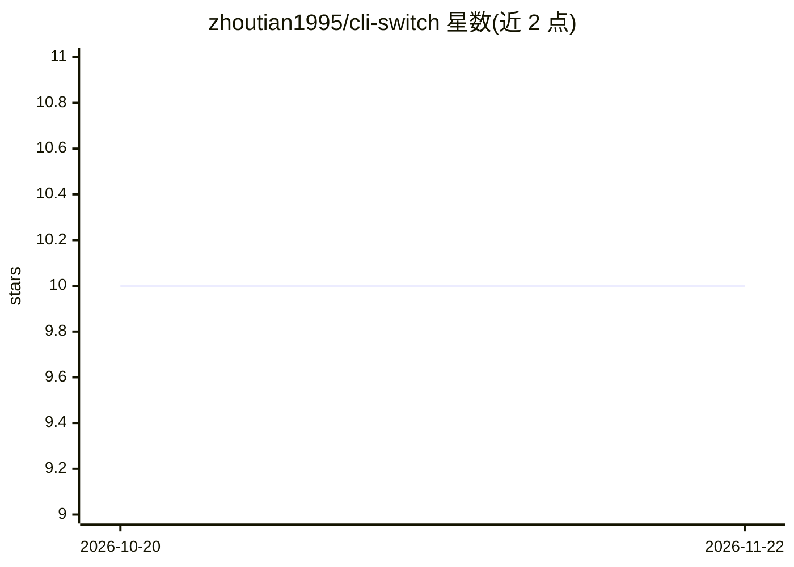

# zhoutian1995/cli-switch

⭐ 10 · TypeScript · MIT · 推送 2026-11-15 · [GitHub](https://github.com/zhoutian1995/cli-switch) · [官网](https://www.npmjs.com/package/cli-switch) · 个人维护 · 中文 README

**为开发者统一路由多个 AI 编程 CLI 的命令行编排层**

位于 Claude Code、Codex CLI 等编程 Agent 之上的命令行路由层：按任务做意图与能力识别，选择 Agent 与模型档位（economy/standard/premium），注入 Gateway/中转站凭据为各 Agent 原生环境变量，在隔离子进程中执行并返回文本或 JSON。支持 patch-only、临时副本、git worktree 三种执行隔离模式，提供全局/项目双层配置、输出 schema 校验与有界自动修复、本地 Skill 工作流。已知限制：--strategy 选项未实现运行时成本策略，Gateway 注入目前仅面向 Claude Code 与 Codex。

## 筛选速览

| 维度 | 判定 | 备注 |
|---|---|---|
| AI 角色 | `ai-ecosystem` | LLM/agent 周边工具 |
| 许可风险 | `permissive` | MIT |
| 部署形态 | `library` | 以包/库形式分发 |
| 模型依赖 | — | README 未给出锁定关系 |
| 硬件要求 | — | 无带数字的原话,不猜 |
| 安装摩擦 | `low` | 无编译、无系统依赖或容器化 |
| 成熟度 | — | 结构信号不足 |

## 能力要点

- 任务级智能路由：自动选择 Claude Code 或 Codex CLI 与模型档位
- Gateway/自建中转站凭据注入为 Agent 原生环境变量（SWITCH_*/OPENROUTER_* 别名）
- worktree、temp-copy、patch-only 隔离执行，保护真实项目
- --dry-run 预览路由决策，--json 供脚本与上层 Agent 消费

## 适用场景

- 在多个编程 Agent 之间按任务自动分派重构、测试、修复工作
- 用一套自建中转站或 OpenRouter 兼容 Key 驱动多个 Agent
- 构建需要稳定 JSON 输出的上层 Agent 工作流与 CI 诊断

## 场景标签

`编码 Agent` · 领域:编码与开发

## 证据(README 行号)

> L10: `cli-switch` is a command-line orchestration layer for AI coding agents. It
> L267: 它不是新的模型，也不是 Claude Code / Codex CLI 的替代品，而是位于这些工具上方

## 星数曲线

2026-10-20 10 → 2026-11-22 10（+0）

---
*卡片 v1 · prompt 1.4 · 生成 2026-11-19 · 置信度 high · 依据 README sha `a0f4460d844c` · [字段定义](../../DATASET.md)*
