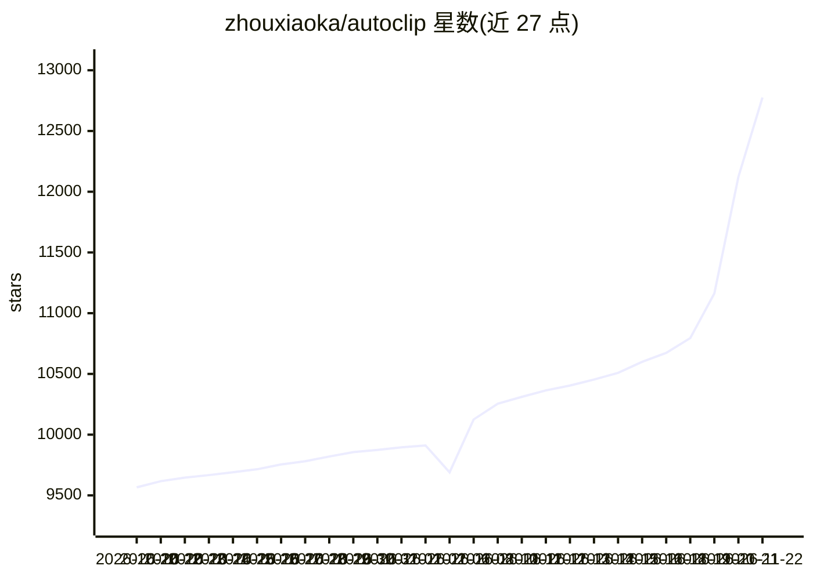

# zhouxiaoka/autoclip

⭐ 12,776 · Python · MIT · 推送 2026-11-21 · [GitHub](https://github.com/zhouxiaoka/autoclip) · [官网](https://zhouxiaoka.github.io/autoclip_intro/) · 个人维护 · 中文 README

**贴链接一键将长视频自动剪成短视频的桌面工具**

AutoClip 是开源（MIT）视频剪辑工具：贴入视频链接后按目标平台画幅与时长自动生成片段、字幕、封面与发布文案，输出 ZIP 发布包，适配抖音、小红书、TikTok、Reels、Shorts、B 站与 YouTube。剪辑、取景与渲染在本机完成；分析模型可用云端 API 或 Ollama / LM Studio 本地模型，字幕可用作者字幕、本地 Whisper / SenseVoice 或云端转写。提供桌面版（macOS Apple Silicon / Windows x64）、Docker 部署与 CLI / MCP 三种使用方式，桌面安装包自带 Python 与 FFmpeg。

## 筛选速览

| 维度 | 判定 | 备注 |
|---|---|---|
| AI 角色 | `ai-native` | 本体是模型或模型工具 |
| 许可风险 | `permissive` | MIT |
| 部署形态 | `desktop` | 安装包/桌面程序 |
| 模型依赖 | local-ok | 支持本地模型 |
| 硬件要求 | — | 无带数字的原话,不猜 |
| 安装摩擦 | `low` | 无编译、无系统依赖或容器化 |
| 成熟度 | — | 结构信号不足 |

## 能力要点

- 贴链接自动生成至多 10 条片段及封面、标题、简介、话题与 ZIP 发布包
- 本地 Whisper / SenseVoice 或云端转写，本地分析无需云端 API
- 桌面、CLI 与 MCP 共用同一出片链路，支持接入 Agent
- 按平台自动选择竖版访谈式/满屏播客式等版式，画面跟随说话人

## 适用场景

- 把播客、访谈、课程长视频批量剪成平台短视频
- 为每条片段自动配字幕、封面和发布文案
- 在 Linux 上自建 Web 服务或通过 MCP 接入 Agent 批量出片

## 场景标签

`视频生成` `AI 写作` `语音识别` · 领域:内容生成

## 证据(README 行号)

> L7: 开源，在你的电脑上剪辑与渲染。贴一个链接，选好平台，生成 视频、封面和发布文案 ，
> L128: 剪辑、取景与渲染在本机完成。分析模型自选，字幕可用作者字幕、本地 Whisper / SenseVoice 或已配置的云端转写。CLI / MCP 与桌面共用同一条一键出片链路。

## 星数曲线

2026-10-20 9,566 → 2026-11-22 12,776（+3,210）

---
*卡片 v1 · prompt 1.4 · 生成 2026-11-22 · 置信度 high · 依据 README sha `f6bb48fd0922` · [字段定义](../../DATASET.md)*
