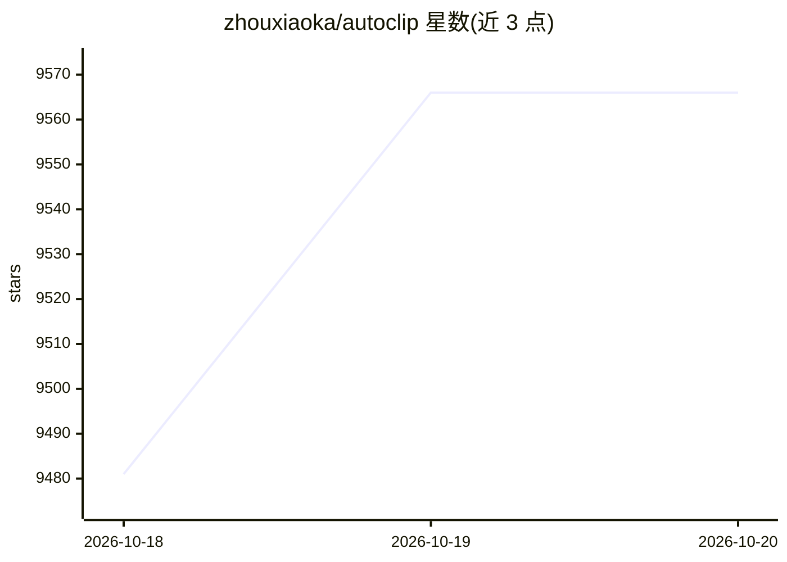

# zhouxiaoka/autoclip

⭐ 9,566 · Python · MIT · 推送 2026-10-19 · [GitHub](https://github.com/zhouxiaoka/autoclip) · [官网](https://zhouxiaoka.github.io/autoclip_intro/) · 个人维护 · 中文 README

**AI 视频剪辑桌面工具：贴链接把长视频自动剪成多平台短视频**

开源桌面应用（另有 Docker/Web 与 CLI/MCP 形态）：粘贴链接后按平台（抖音、小红书、TikTok、Reels、Shorts、B 站、YouTube）的画幅与时长要求自动生成至多 10 条片段，每条附封面、标题、简介与 ZIP 发布包。剪辑、取景与渲染在本机完成；分析模型可选云端 API（OpenAI 兼容、自填 Key）或 Ollama/LM Studio 本地模型，字幕可用作者字幕、本地 Whisper/SenseVoice 或云端转写。软件免费 MIT，云端模型按量计费。个人维护。

## 筛选速览

| 维度 | 判定 | 备注 |
|---|---|---|
| AI 角色 | `ai-native` | 本体是模型或模型工具 |
| 许可风险 | `permissive` | MIT |
| 部署形态 | `desktop` | 安装包/桌面程序 |
| 模型依赖 | local-ok | 支持本地模型 |
| 硬件要求 | — | 无带数字的原话,不猜 |
| 安装摩擦 | `low` | 无编译、无系统依赖或容器化 |
| 成熟度 | — | 结构信号不足 |

## 能力要点

- 按平台规则自动选段，每条片段附封面、文案与 ZIP 发布包
- 剪辑与渲染在本地完成，分析模型可选云端或 Ollama/LM Studio 本地
- 字幕支持作者字幕、本地 Whisper/SenseVoice 与云端转写
- 提供桌面版、Docker/Web、CLI 与 MCP 三种使用形态

## 适用场景

- 把播客、访谈、课程长视频剪成多平台短视频
- 批量处理视频素材或通过 Agent/CLI 自动化出片
- 无字幕素材自动转写并生成字幕与发布文案

## 场景标签

`图像视频处理` `语音识别` `AI 写作` · 领域:内容生成

## 证据(README 行号)

> L7: 开源，在你的电脑上剪辑与渲染。贴一个链接，选好平台，生成 视频、封面和发布文案 ，
> L120: 选好平台，按平台的画幅与时长要求自动生成。每个平台按评分自动生成至多 10 条合格片段，其余列为备选，点「生成这条」再制作。每条都带封面、标题、简介、话题和 ZIP 发布包。
> L128: 剪辑、取景与渲染在本机完成。分析模型自选，字幕可用作者字幕、本地 Whisper / SenseVoice 或已配置的云端转写。CLI / MCP 与桌面共用同一条一键出片链路。

## 星数曲线

2026-10-18 9,481 → 2026-10-20 9,566（+85）

---
*卡片 v1 · prompt 1.4 · 生成 2026-10-20 · 置信度 mid · 依据 README sha `fa3b2f1be090` · [字段定义](../../DATASET.md)*
