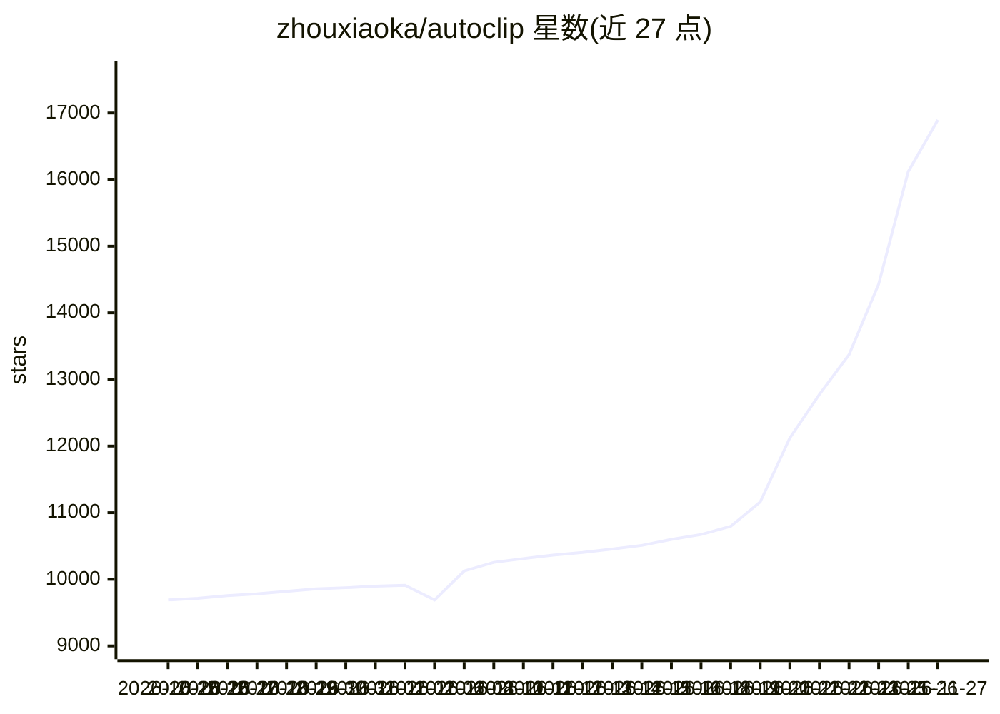

# zhouxiaoka/autoclip

⭐ 16,895 · Python · MIT · 推送 2026-11-26 · [GitHub](https://github.com/zhouxiaoka/autoclip) · [官网](https://zhouxiaoka.github.io/autoclip_intro/) · 个人维护 · 中文 README

**面向创作者的本地 AI 长视频自动剪辑出片工具**

桌面应用与 MCP 服务：输入视频链接、本地文件或直播回放，自动选取精彩片段、追踪说话人、烧录字幕、生成封面与发布文案，导出适配 TikTok、Shorts、Reels、抖音、小红书、B 站等平台的短视频。剪辑与渲染在本地执行，可自带 API key 调云端模型，也可通过 Ollama/LM Studio 加 Whisper/SenseVoice 完全离线运行；另提供 CLI 与 MCP 接口供 Claude Code 等 AI agent 调用。桌面安装包捆绑 Python 与 FFmpeg，支持 Docker 自托管，MIT 许可。

## 筛选速览

| 维度 | 判定 | 备注 |
|---|---|---|
| AI 角色 | `ai-native` | 本体是模型或模型工具 |
| 许可风险 | `permissive` | MIT |
| 部署形态 | `desktop` | 安装包/桌面程序 |
| 模型依赖 | local-ok | 支持本地模型 |
| 硬件要求 | — | 无带数字的原话,不猜 |
| 安装摩擦 | `low` | 无编译、无系统依赖或容器化 |
| 成熟度 | — | 结构信号不足 |

## 能力要点

- 支持链接、本地文件与 6 种直播回放源（OBS/Twitch/YouTube/Kick/Discord/本地录制）
- 本地剪辑渲染，Ollama/LM Studio + Whisper/SenseVoice 可完全离线
- 内置 MCP server，可被 AI coding agent 从终端调用
- 13 种语言的 UI 与文档，支持一键切换导出平台

## 适用场景

- 把播客、访谈、课程长视频批量剪成多平台短视频
- 直播结束后自动截取高光片段并加字幕发布
- 让 Claude Code/Cursor 等 agent 通过 MCP 直接剪辑视频
- 无网络或不愿上传视频的本地化剪辑流程

## 场景标签

`图像视频处理` · 领域:感知与多模态

## 证据(README 行号)

> L45: Drop in a link, local video, or **live stream replay** — AutoClip finds the best moments, tracks the speaker, burns
> L188: Let AI coding agents clip videos directly from your terminal (`claude mcp add autoclip -- uvx autoclip-mcp`). Full

## 星数曲线

2026-10-25 9,690 → 2026-11-27 16,895（+7,205）

---
*卡片 v1 · prompt 1.4 · 生成 2026-11-27 · 置信度 high · 依据 README sha `b4261252ee4b` · [字段定义](../../DATASET.md)*
