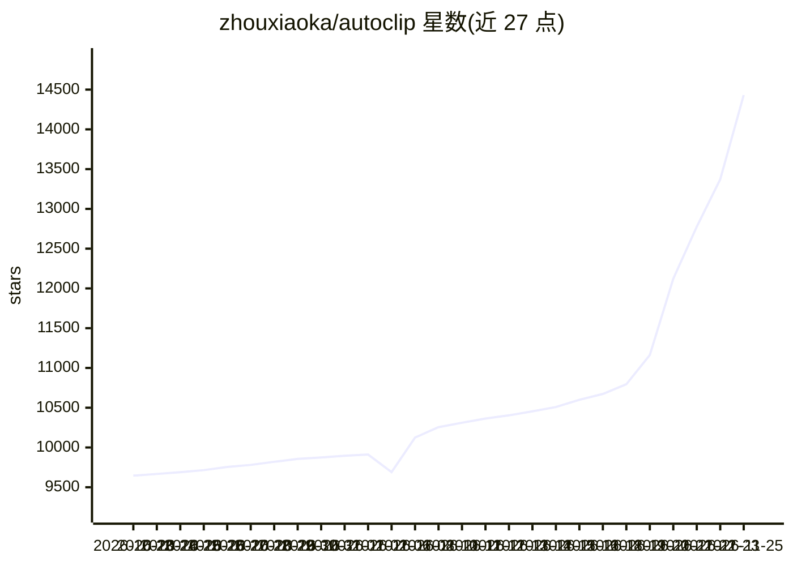

# zhouxiaoka/autoclip

⭐ 14,431 · Python · MIT · 推送 2026-11-23 · [GitHub](https://github.com/zhouxiaoka/autoclip) · [官网](https://zhouxiaoka.github.io/autoclip_intro/) · 个人维护 · 中文 README

**给内容创作者：贴链接一键把长视频剪成多平台短视频**

开源桌面工具，将播客、访谈、课程等长视频链接自动剪辑为适配抖音、小红书、TikTok、Reels、YouTube Shorts、B 站与 YouTube 的短视频，生成字幕、封面、标题简介与 ZIP 发布包，每平台按评分生成至多 10 条片段并可补充备选。剪辑与渲染在本机完成；分析模型可选云端 API 或 Ollama/LM Studio 本地模型，字幕可用作者字幕、本地 Whisper/SenseVoice 或云端转写。提供桌面版、Docker/Web、CLI 与 MCP 四种使用方式；软件 MIT 免费，云端模型按量计费。Intel Mac 无桌面安装包，需用 Docker 或 CLI。

## 筛选速览

| 维度 | 判定 | 备注 |
|---|---|---|
| AI 角色 | `ai-native` | 本体是模型或模型工具 |
| 许可风险 | `permissive` | MIT |
| 部署形态 | `desktop` | 安装包/桌面程序 |
| 模型依赖 | local-ok | 支持本地模型 |
| 硬件要求 | — | 无带数字的原话,不猜 |
| 安装摩擦 | `low` | 无编译、无系统依赖或容器化 |
| 成熟度 | — | 结构信号不足 |

## 能力要点

- 贴链接一键生成视频、封面与发布文案，适配 7 个平台
- 剪辑、取景与渲染在本机完成，模型可自选云端或本地（Ollama/LM Studio）
- 提供桌面版、Docker/Web、CLI 与 MCP 四种使用方式
- 支持连接账号直接投稿到平台

## 适用场景

- 把播客或访谈长视频批量剪成抖音/小红书竖版短片
- 为 YouTube 长视频生成 Shorts 切片并附发布文案
- 通过 CLI/MCP 把剪辑流程接入自建服务或 Agent

## 场景标签

`语音识别` · 领域:感知与多模态

## 证据(README 行号)

> L7: 开源，在你的电脑上剪辑与渲染。贴一个链接，选好平台，生成 视频、封面和发布文案 ，
> L128: 剪辑、取景与渲染在本机完成。分析模型自选，字幕可用作者字幕、本地 Whisper / SenseVoice 或已配置的云端转写。CLI / MCP 与桌面共用同一条一键出片链路。

## 星数曲线

2026-10-23 9,646 → 2026-11-25 14,431（+4,785）

---
*卡片 v1 · prompt 1.4 · 生成 2026-11-24 · 置信度 high · 依据 README sha `3fc21cf44012` · [字段定义](../../DATASET.md)*
