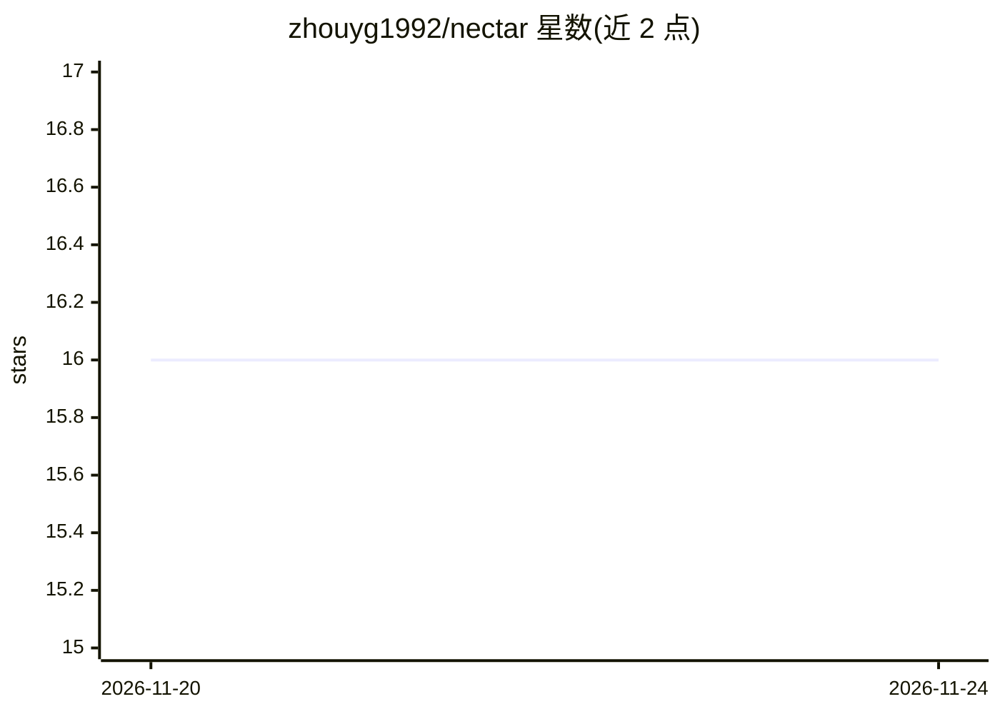

# zhouyg1992/nectar

⭐ 16 · Go · MIT · 推送 2026-11-23 · [GitHub](https://github.com/zhouyg1992/nectar) · 个人维护 · 中文 README

**把飞书/钉钉/Telegram 消息路由给多个编码 agent 并管理会话与任务**

Nectar 以单个进程在同一仓库中并行运行多个编码 agent（Codex、Claude Code、Cursor Agent、OpenCode、Pi），并把 Feishu/Lark、钉钉、Telegram 的聊天消息路由给它们，再回传进度与结果。机制上每个会话使用独立 git worktree 隔离冲突，提供待审批的记忆候选注入、运行中任务的 /steer 等插话命令、会话持久化管理，以及 cron/间隔/一次性定时任务和文件收发。要求 macOS/Linux（Windows 经 WSL），需预装并登录至少一个引擎。

## 筛选速览

| 维度 | 判定 | 备注 |
|---|---|---|
| AI 角色 | `ai-ecosystem` | LLM/agent 周边工具 |
| 许可风险 | `permissive` | MIT |
| 部署形态 | `None` |  |
| 模型依赖 | locked-api |  |
| 硬件要求 | — | 无带数字的原话,不猜 |
| 安装摩擦 | `low` | 无编译、无系统依赖或容器化 |
| 成熟度 | — | 结构信号不足 |

## 能力要点

- 每会话独立 git worktree，同仓库并行运行多 agent 不冲突
- 失败运行产生 pending 记忆候选，审批后才注入，支持 bot/project/chat 三级作用域
- /steer、/append、/ps、/btw 向运行中的任务插入上下文
- cron、固定间隔、一次性定时任务与图片/文件双向传输

## 适用场景

- 在飞书或钉钉群里通过 @机器人驱动本机编码 agent 干活
- 多个 agent 同时在同一仓库并行处理不同任务
- 用 /steer 在任务运行中途补充要求而不打断
- 用自然语言定时任务让 agent 周期性执行工作

## 场景标签

`编码 Agent` `多智能体` `聊天机器人` · 领域:Agent 开发

## 证据(README 行号)

> L15: Nectar routes chat messages to coding agents on your machine and streams progress and results back. It does more th
> L17:  Feishu, DingTalk, and Telegram messages flow through Nectar to Codex, OpenCode, Cursor Agent, Claude Code, or Pi

## 星数曲线

2026-11-20 16 → 2026-11-24 16（+0）

---
*卡片 v1 · prompt 1.4 · 生成 2026-11-20 · 置信度 high · 依据 README sha `a1ca0d4efac0` · [字段定义](../../DATASET.md)*
