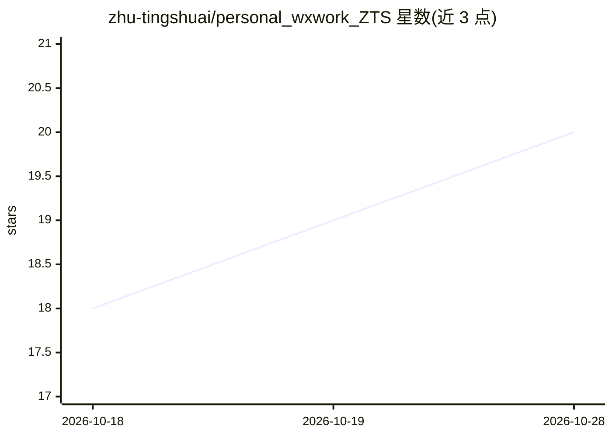

# zhu-tingshuai/personal_wxwork_ZTS

⭐ 20 · Python · MIT · 推送 2026-07-02 · [GitHub](https://github.com/zhu-tingshuai/personal_wxwork_ZTS) · 个人维护 · 中文 README

**不依赖企微 API 的企业微信私聊自动回复桌面系统**

通过截图 RPA 模拟人工操作企业微信客户端：定时扫描左侧红点检测未读消息，PaddleOCR（PP-OCRv4）识别聊天文本，基于 Qdrant + BGE 的本地 RAG 知识库检索后调用 DeepSeek API 生成回复，并按三级分流（自动发送/人工确认/人工处理）发送。面向无企微 API 权限的小微企业与个人，提供 Python 运行与一键打包 Windows 可执行程序两种方式。已知限制：仅支持 1 对 1 私聊，企微窗口须前台可见。

## 筛选速览

| 维度 | 判定 | 备注 |
|---|---|---|
| AI 角色 | `ai-native` | 本体是模型或模型工具 |
| 许可风险 | `permissive` | MIT |
| 部署形态 | `library` | 以包/库形式分发 |
| 模型依赖 | locked-api |  |
| 硬件要求 | — | 无带数字的原话,不猜 |
| 安装摩擦 | `low` | 无编译、无系统依赖或容器化 |
| 成熟度 | — | 结构信号不足 |

## 能力要点

- 截图 RPA 路径，不需要企业微信 API 与管理员权限
- PaddleOCR 中文识别 + Qdrant/BGE 本地 RAG + DeepSeek 生成回复
- 三级分流：自动发送 / 人工确认 / 人工处理
- 一键打包为约 3GB 的免 Python 环境 Windows 可执行程序

## 适用场景

- 没有企微 API 权限的小微企业/个人做私聊自动客服
- 把聊天记录和文档导入知识库生成定制回复
- 在人工审核环节把关高风险回复

## 场景标签

 · 领域:企业通讯自动化/智能客服

## 证据(README 行号)

> L3: > 基于截图 RPA + PaddleOCR + RAG 知识库的企业微信 1 对 1 私聊自动回复系统。
> L10: - 🧠 RAG 知识库检索 + DeepSeek AI 生成回复
> L31: |AI 回复|DeepSeek API|LLM 生成 + 质量门控（三态）|

## 星数曲线

2026-10-18 18 → 2026-10-28 20（+2）

---
*卡片 v1 · prompt 1.4 · 生成 2026-10-28 · 置信度 mid · 依据 README sha `9d2a497b591e` · [字段定义](../../DATASET.md)*
