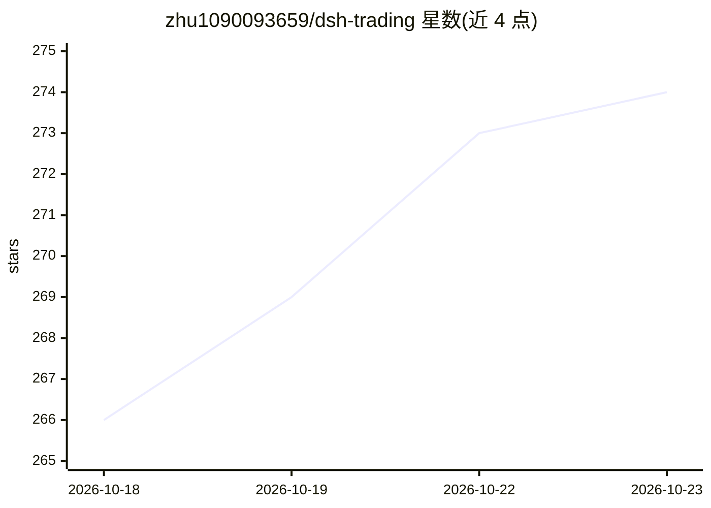

# zhu1090093659/dsh-trading

⭐ 274 · TypeScript · NOASSERTION · 推送 2026-10-22 · [GitHub](https://github.com/zhu1090093659/dsh-trading) · [官网](https://dsh-trading.win) · 个人维护 · 中文 README

**给个人交易者的 agent 原生多市场交易终端与量化研究平台**

基于 DeepSeek Harness（DSH）与 Cordis 微内核的开源交易终端：三栏 GUI 聚合加密货币、美股、A股、港股与中国商品期货行情，提供 19+ 热插拔行情/经纪商连接器、TradingView Lightweight Charts v5 图表、内置策略回测与指标编写。AI 侧以角色化多智能体团队（master/researcher/trader/risk-reviewer）自主查询行情工具、做财报分析与估值研究并起草交易计划；订单默认 dry-run 模拟，实盘需 liveTrading 显式开启并经人工确认门与 Ed25519 权限层，无头环境 fail-closed。BYOK，密钥与交易记录仅存本地。安装器按启用市场生成四个角色预设。

## 筛选速览

| 维度 | 判定 | 备注 |
|---|---|---|
| AI 角色 | `ai-native` | 本体是模型或模型工具 |
| 许可风险 | `none` | NOASSERTION |
| 部署形态 | `library` | 以包/库形式分发 |
| 模型依赖 | — | README 未给出锁定关系 |
| 硬件要求 | — | 无带数字的原话,不猜 |
| 安装摩擦 | `low` | 无编译、无系统依赖或容器化 |
| 成熟度 | — | 结构信号不足 |

## 能力要点

- 多市场统一工作区：加密、美股、A股、港股、商品期货，19+ 连接器
- 角色化多智能体团队（master/researcher/trader/risk-reviewer）驱动原生行情与研究工具
- 零信任双轨审批：默认 dry-run，实盘订单需人工确认与 Ed25519 权限层，无头环境 fail-closed
- 内置 strategy_backtest 回测引擎与 15+ 技术指标、机构级研究清单与估值手册

## 适用场景

- 在一个终端里同时跟踪加密货币、美股、A股、港股持仓与行情
- 让 AI 研究团队起草交易计划并做风险压力测试，实盘前人工审批
- 对系统化交易信号做历史回测与自定义指标验证

## 场景标签

 · 领域:金融交易/量化投资

## 证据(README 行号)

> L7: **dsh-trading** is an open-source, agent-native AI trading terminal and quantitative investment research platform bu
> L30: - **Agent-Native Multi-Agent Orchestration:** A collaborative AI team (`master` lead, `instrument-researcher`, `tra
> L33: - **Zero-Trust Safety & Dual-Track Approval Gate:** Dry-run simulation by default; live broker orders require expli

## 星数曲线

2026-10-18 266 → 2026-10-23 274（+8）

---
*卡片 v1 · prompt 1.4 · 生成 2026-10-22 · 置信度 mid · 依据 README sha `d2e6945bdef4` · [字段定义](../../DATASET.md)*
