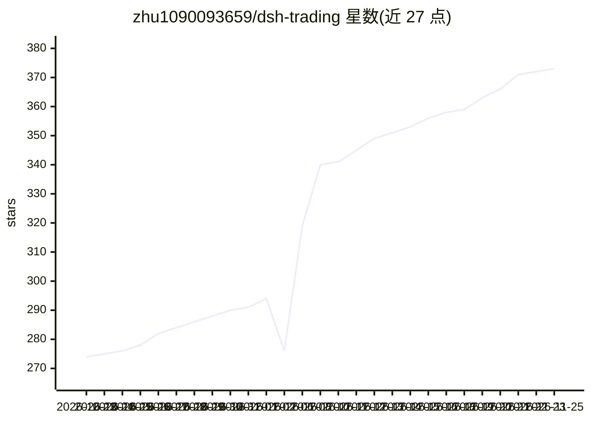

# zhu1090093659/dsh-trading

⭐ 373 · TypeScript · NOASSERTION · 推送 2026-11-22 · [GitHub](https://github.com/zhu1090093659/dsh-trading) · [官网](https://dsh-trading.win) · 个人维护 · 中文 README

**面向个人交易者的 agent-native 多市场交易终端，实盘下单前须人工审批**

基于 DeepSeek Harness（DSH）与 Cordis 微内核构建的开源交易终端与多智能体量化研究平台，覆盖加密货币、美股、A股、港股、国内期货及全球商品/外汇/预测市场，提供 19+ 可热插拔连接器。界面为三列工作台：行情图表（TradingView Lightweight Charts v5）、策略回测与选股器、知识图谱，以及右侧任务/持仓/快讯面板。多智能体团队由 master 统领，含研究员、交易员、风险审查员角色。默认 dry-run 模拟，实盘单需显式开启 liveTrading 并通过交互式人工审批与 Ed25519 授权，无头环境 fail-closed。BYOK，密钥与数据保存在本地。

## 筛选速览

| 维度 | 判定 | 备注 |
|---|---|---|
| AI 角色 | `ai-native` | 本体是模型或模型工具 |
| 许可风险 | `none` | NOASSERTION |
| 部署形态 | `desktop` | 安装包/桌面程序 |
| 模型依赖 | — | README 未给出锁定关系 |
| 硬件要求 | — | 无带数字的原话,不猜 |
| 安装摩擦 | `low` | 无编译、无系统依赖或容器化 |
| 成熟度 | — | 结构信号不足 |

## 能力要点

- 单一工作台覆盖六大市场，19+ 连接器（Binance、OKX、Alpaca、IB、MiniQMT、Longbridge 等）
- 多智能体团队：master + researcher/trader/risk-reviewer 三个委托预设
- 双轨审批门：默认 dry-run，实盘需显式开启、人工点击审批与 Ed25519 授权
- 内置策略回测引擎（6 种范式）与 5 个市场选股器

## 适用场景

- 在同一个终端里看加密货币、美股、A股、港股行情并管理持仓
- 让 AI agent 按内置风控清单做交易前分析并起草交易计划
- 本地回测趋势/均值回归等策略并运行市场筛选器
- 实盘下单前强制人工审批，防止 agent 擅自执行

## 场景标签

`多智能体` `知识图谱` `金融量化` · 领域:Agent 开发

## 证据(README 行号)

> L7: **dsh-trading** is an open-source, agent-native AI trading terminal, cross-platform desktop application (macOS / Win
> L9: Combining TradingView Lightweight Charts v5 (with right-click **KDAS key-day anchored lines** and cross-source 5-day
> L35: - **Zero-Trust Dual-Track Gate & BYOK Privacy:** Order routing defaults to dry-run simulation; live orders require 

## 星数曲线

2026-10-23 274 → 2026-11-25 373（+99）

---
*卡片 v1 · prompt 1.4 · 生成 2026-11-25 · 置信度 mid · 依据 README sha `276a0acabada` · [字段定义](../../DATASET.md)*
