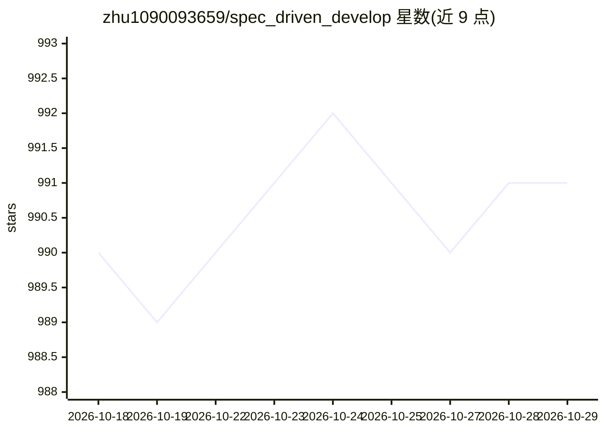

# zhu1090093659/spec_driven_develop

⭐ 991 · Shell · MIT · 推送 2026-07-26 · [GitHub](https://github.com/zhu1090093659/spec_driven_develop) · 个人维护 · 中文 README

**给 AI 编程 agent 的规格驱动开发工作流插件（纯 Markdown）**

面向使用 AI 编程 agent 的开发者的工作流插件，以纯 Markdown 技能形式分发，无 SDK 与第三方运行时依赖。提供三个技能：Spec-Driven Develop 将大型变更拆为 0-6 七阶段流水线（意图捕获、深度分析、规格、规划、执行、验收），自动创建 GitHub Issue/Milestone/标签并按阶段产出批量 PR，无 GitHub 时降级为本地模式；Deep Discuss 做七阶段结构化深度讨论；review-spd 做 findings-first 代码审查（未提交变更/日期区间/分支 PR diff）。内含基于工程控制论的漂移检测闭环（20%/40%/60% 阈值分级响应）与 S.U.P.E.R 架构原则检查表。兼容 Claude Code、Codex、OpenCode、Cursor 等 Markdown-capable agent。

## 筛选速览

| 维度 | 判定 | 备注 |
|---|---|---|
| AI 角色 | `ai-ecosystem` | LLM/agent 周边工具 |
| 许可风险 | `permissive` | MIT |
| 部署形态 | `None` |  |
| 模型依赖 | — | README 未给出锁定关系 |
| 硬件要求 | — | 无带数字的原话,不猜 |
| 安装摩擦 | `low` | 无编译、无系统依赖或容器化 |
| 成熟度 | — | 结构信号不足 |

## 能力要点

- 七阶段（0-6）规格驱动流水线与分阶段任务分解
- GitHub Issue/Milestone/Label 自动跟踪与每阶段批量 PR，支持三种自动检测模式
- 执行遥测与漂移分数驱动的自适应控制（工程控制论启发）
- Deep Discuss 结构化讨论与 review-spd findings-first 代码审查两个附加技能

## 适用场景

- 让 AI 编程 agent 接手大型重写、迁移或架构变更并保持进度可追踪
- 通过 GitHub Issue 与批量 PR 管理复杂实施计划
- 对未提交变更或分支 diff 做 bug 优先的代码审查

## 场景标签

`编码 Agent` `代码审查` · 领域:编码与开发

## 证据(README 行号)

> L10: **An architecture-first workflow plugin for AI coding agents. Pure Markdown. Claude Code, Codex, OpenCode, Cursor, 
> L12: Spec-Driven Develop is an open-source, platform-agnostic workflow for AI coding agents. It turns large software cha
> L20: No SDK. No third-party runtime dependencies. Just Markdown workflows plus small helper scripts that AI coding agent

## 星数曲线

2026-10-18 990 → 2026-10-29 991（+1）

---
*卡片 v1 · prompt 1.4 · 生成 2026-10-21 · 置信度 high · 依据 README sha `ab54b9e71524` · [字段定义](../../DATASET.md)*
