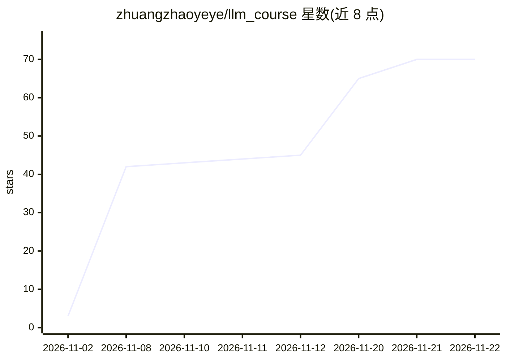

# zhuangzhaoyeye/llm_course

⭐ 70 · HTML · MIT · 推送 2026-11-17 · [GitHub](https://github.com/zhuangzhaoyeye/llm_course) · [官网](https://zhuangzhaoyeye.github.io/llm-course/) · 个人维护 · 中文 README

**写给传统算法工程师的大模型课程：每课用具体数字算一遍机制**

面向从推荐算法等方向转大模型的算法工程师的中文课程：43 课、每课 6 张卡片，覆盖 Transformer 回顾、训练范式、训练与推理工程、Agent 工程、自主研究与前沿决策模型（JEV/Drex/DPDM）。以“问题→撞墙→逼出解法”的因果链组织内容，每条机制用最小真实例子逐步计算（如 LoRA 参数压缩、KV Cache 显存账）。产物为自包含单文件 HTML 与多页站点，免登录在线阅读，含站内关键词+语义搜索、每卡片 AI 助教（DeepSeek，有额度限制）。课程由“检索→写卡片→逐条核验→机械门禁→独立盲审”流水线生成，作者如实公开了盲审查出的 186 条缺陷与漏检率数字。本地构建仅需 Python 3。

## 筛选速览

| 维度 | 判定 | 备注 |
|---|---|---|
| AI 角色 | `ai-knowledge` | 知识聚合/清单类 |
| 许可风险 | `permissive` | MIT |
| 部署形态 | `library` | 以包/库形式分发 |
| 模型依赖 | — | README 未给出锁定关系 |
| 硬件要求 | — | 无带数字的原话,不猜 |
| 安装摩擦 | `low` | 无编译、无系统依赖或容器化 |
| 成熟度 | — | 结构信号不足 |

## 能力要点

- 43 课、每课 6 张卡片，从 Transformer 到 Agent 与决策模型
- 每个机制用具体数字从头计算（0.95¹⁰、LoRA 压缩 256 倍、KV Cache 2.5 GiB 等）
- 单文件 HTML 可离线打开，KaTeX 内联、无 CDN 依赖
- 每卡片内嵌 AI 助教，上下文限定为本卡片内容，不联网、有额度限制

## 适用场景

- 算法工程师系统性补齐 Transformer 到 Agent 的大模型知识
- 想知道某个机制‘为什么必须这样设计’时按因果链学习
- 离线或手机上阅读并跟随计算走查推导

## 场景标签

`教程课程` · 领域:学习与行业

## 证据(README 行号)

> L4: > 这套写给**传统算法工程师**的大模型课程，从 Transformer 一路讲到 Agent，再追到 2026 年的决策模型（JEV / Drex）与后训练范式：40+ 门课、每课 6 张卡片（持续新增），每张从一个问题出发，用
> L108: |一 · 认知衔接|1–6|Transformer 回顾、模型结构全景、现代 Transformer 的五大改造、Tokenization、逐层解剖一个模型、从 Transformer 到 LLM 全景图|
> L113: |六 · 前沿拓展|35|决策模型（JEV / Drex / DPDM）：不写一个字，直接输出每个选项的概率|

## 星数曲线

2026-11-02 3 → 2026-11-22 70（+67）

---
*卡片 v1 · prompt 1.4 · 生成 2026-11-18 · 置信度 mid · 依据 README sha `3341f204bbe5` · [字段定义](../../DATASET.md)*
