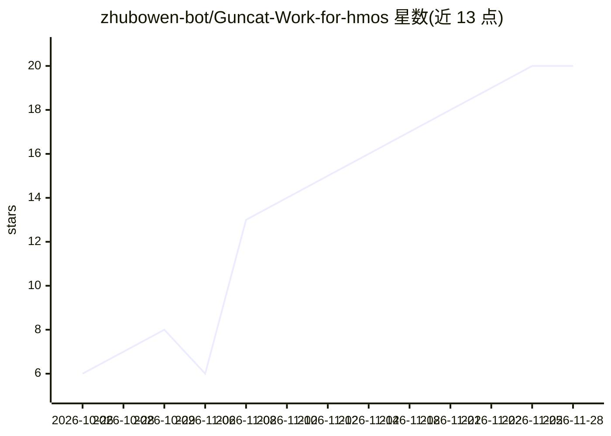

# zhubowen-bot/Guncat-Work-for-hmos

⭐ 20 · TypeScript · Apache-2.0 · 推送 2026-11-15 · [GitHub](https://github.com/zhubowen-bot/Guncat-Work-for-hmos) · [官网](https://appgallery.huawei.com/apptest/955nTWBlvx0) · 个人维护 · 中文 README

**鸿蒙手机上的原生 AI 工作台：端侧 Agent Loop + 原生 shell/Python**

用 ArkTS/ArkUI 构建的 HarmonyOS 应用，提供交互模式（一句话生成可操作原生界面）与工作模式（多轮工具循环 + 沙箱工作区）两种 Agent 形态。端侧执行环境包括编成 HarmonyOS .so 的原生 CPython 3.12（numpy/pandas 等离线可用）和原生 shell（mksh/toybox/git/ssh/node，无虚拟机），内置 47 个工具与 32 个技能，可本地生成 PPT/Word/Excel/SVG。应用不内置大模型，用户自行配置 API（支持 OpenAI Completions/Responses 与 Anthropic 三协议）。构建需 DevEco Studio 26、HarmonyOS SDK API 26 与真机，HAP 约 420 MiB。

## 筛选速览

| 维度 | 判定 | 备注 |
|---|---|---|
| AI 角色 | `ai-native` | 本体是模型或模型工具 |
| 许可风险 | `permissive` | Apache-2.0 |
| 部署形态 | `library` | 以包/库形式分发 |
| 模型依赖 | — | README 未给出锁定关系 |
| 硬件要求 | — | 无带数字的原话,不猜 |
| 安装摩擦 | `medium` | 含编译或系统依赖之一 |
| 成熟度 | — | 结构信号不足 |

## 能力要点

- 原生 CPython 3.12 编成 HarmonyOS .so 进程内直跑，numpy/pandas/scipy 离线可用
- 原生 shell 无虚拟机：mksh/toybox/git/dropbear/node 均为 HarmonyOS .so
- 47 个内置工具 + 32 个技能的端侧 Agent Loop
- Intelligent UI 一句话直出原生可操作界面，控件取值可回传模型重算

## 适用场景

- 在鸿蒙手机上运行多轮工具调用的长程 AI 任务并本地产出 Office 文档
- 通过对话生成可交互的原生数据界面（图表/表单即时重算）
- 在手机端离线使用 Python 科学计算与 Linux 命令行环境

## 场景标签

`AI 助手` · 领域:对话与助手

## 证据(README 行号)

> L5: **鸿蒙手机上的原生 AI 工作台** —— 用 ArkTS / ArkUI 从零构建，非套壳。**鸿蒙手机可用，不止鸿蒙电脑**：**原生 `shell`**（mksh + toybox/libarchive/git/ssh/no
> L55: Guncat Work 是**鸿蒙手机上的原生 AI 工作台**：它不只负责对话，还把"干活需要的东西"搬进了手机——一个真正的 Linux、一个原生 Python、一套能读写工作区的工具，以及一条能把结果直接交付成文件的链路。
> L73: - **AI 生成内容标识**：对话/工作模式回答、交互模式界面、复制文本与导出的 Word / PowerPoint / Excel / SVG 均带 `AI生成` 显式标识；Office 文件在 `docProps/custo

## 星数曲线

2026-10-26 6 → 2026-11-28 20（+14）

---
*卡片 v1 · prompt 1.4 · 生成 2026-11-18 · 置信度 mid · 依据 README sha `b0177329ebc5` · [字段定义](../../DATASET.md)*
