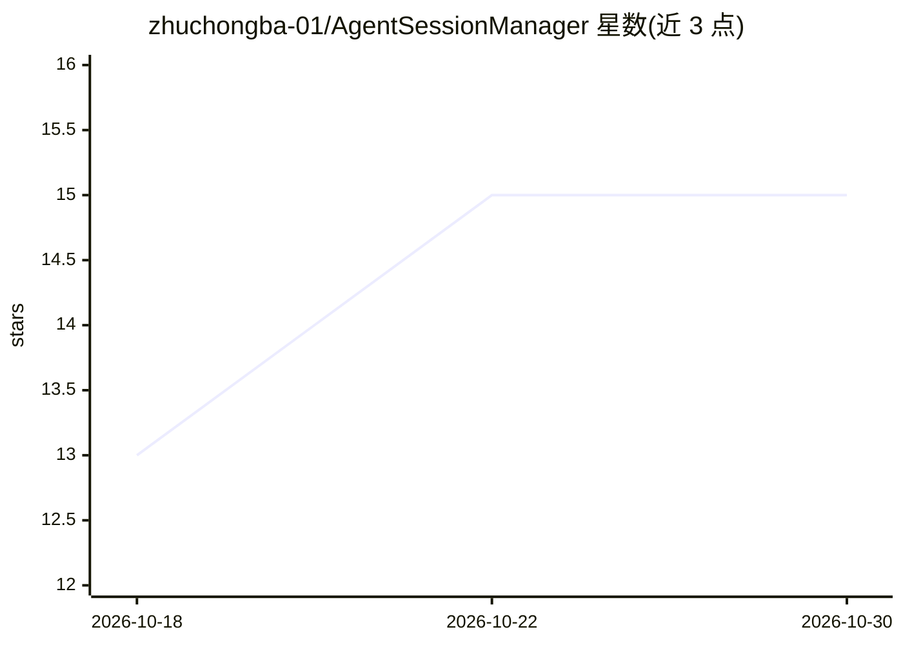

# zhuchongba-01/AgentSessionManager

⭐ 15 · Rust · MIT · 推送 2026-10-16 · [GitHub](https://github.com/zhuchongba-01/AgentSessionManager) · [官网](https://github.com/zhuchongba-01/AgentSessionManager/releases) · 个人维护 · 中文 README

**七种本地编码 Agent 的会话管理桌面工具：浏览/清理历史会话**

基于 Tauri + Rust 的 Windows/Linux 桌面应用，读取 Codex、Claude Code、DeepSeek Harness、OpenCode、ZCode、Pi、Grok Build 七种本地编码 Agent 的会话数据文件，提供按 Agent 与项目分组的浏览、搜索、完整对话时间线查看、残留识别、批量删除与失败续清。只读取不改写各 Agent 内部格式，不启动 Agent、不恢复会话；删除为永久操作不进回收站。会话内容不上传，启动时仅访问 GitHub API 检查更新。Releases 提供安装包，无需预装运行时。

## 筛选速览

| 维度 | 判定 | 备注 |
|---|---|---|
| AI 角色 | `ai-ecosystem` | LLM/agent 周边工具 |
| 许可风险 | `permissive` | MIT |
| 部署形态 | `desktop` | 安装包/桌面程序 |
| 模型依赖 | locked-api |  |
| 硬件要求 | — | 无带数字的原话,不猜 |
| 安装摩擦 | `medium` | 含编译或系统依赖之一 |
| 成熟度 | — | 结构信号不足 |

## 能力要点

- 一站式管理七种本地编码 Agent 的会话，遵循各 Agent 项目绑定
- 批量删除含逐条核对确认与子会话整链清理（子先于父）
- 只读取会话文件、不改写 Agent 内部格式，符号链接只删链接本身
- 扫描、展示与摘要全部本地完成，不上传会话内容

## 适用场景

- 查看和搜索我分散在各编码 Agent 里的历史会话
- 批量清理占空间的残留会话与子 Agent 会话
- 删除前核对每条会话，避免误删重要记录

## 场景标签

 · 领域:开发者工具/桌面应用

## 证据(README 行号)

> L5: **Codex、Claude Code、DeepSeek Harness、OpenCode、ZCode、Pi 与 Grok Build 七种本地编码 Agent 的会话管理工具**
> L19: 面向本地编码 Agent 的独立会话管理工具：浏览、搜索、分类与安全清理历史会话。当前版本不负责启动 Agent 或恢复会话，需要恢复会话请在原 Agent 中操作。
> L35: Windows 下 `~` 即 `%USERPROFILE%`。本管理器只读取上述文件，不改写各 Agent 的内部格式。

## 星数曲线

2026-10-18 13 → 2026-10-30 15（+2）

---
*卡片 v1 · prompt 1.4 · 生成 2026-10-30 · 置信度 mid · 依据 README sha `dfed1771f456` · [字段定义](../../DATASET.md)*
