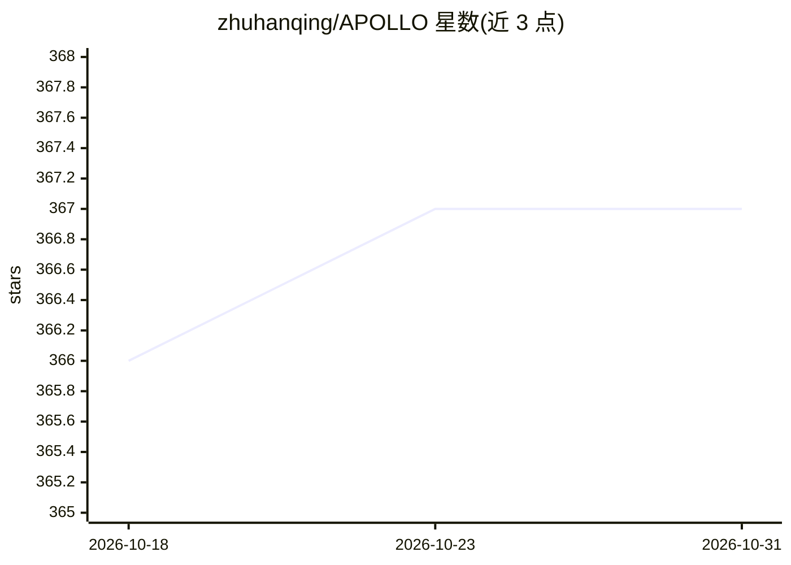

# zhuhanqing/APOLLO

⭐ 367 · Python · NOASSERTION · 推送 2025-11-29 · [GitHub](https://github.com/zhuhanqing/APOLLO) · [官网](https://zhuhanqing.github.io/APOLLO/) · 组织维护

**面向 LLM 训练的内存高效优化器：SGD 级内存、AdamW 级性能**

用于大语言模型预训练与全参数微调的 PyTorch 优化器：在辅助低秩空间用纯随机投影近似通道级梯度缩放（APOLLO），APOLLO-Mini 用 rank-1 子空间做张量级缩放，以降低优化器状态内存。无需 SVD。已集成进 Hugging Face Transformers 与 LLaMA-Factory，支持 FSDP；组合量化可在 12GB 以下内存预训练 LLaMA-7B。提供 pip 安装与预训练/微调基准脚本，论文发表于 MLSys 2025。

## 筛选速览

| 维度 | 判定 | 备注 |
|---|---|---|
| AI 角色 | `ai-ecosystem` | LLM/agent 周边工具 |
| 许可风险 | `none` | NOASSERTION |
| 部署形态 | `library` | 以包/库形式分发 |
| 模型依赖 | — | README 未给出锁定关系 |
| 硬件要求 | — | 无带数字的原话,不猜 |
| 安装摩擦 | `low` | 无编译、无系统依赖或容器化 |
| 成熟度 | — | 结构信号不足 |

## 能力要点

- 低秩辅助空间随机投影近似通道级梯度缩放，无需 SVD
- APOLLO-Mini 用 rank-1 子空间实现张量级缩放
- 已集成 Hugging Face Transformers、LLaMA-Factory，支持 FSDP
- 组合量化可在单卡 11GB 内存内预训练 LLaMA-7B

## 适用场景

- 降低 LLM 预训练与全参数微调的优化器内存占用
- 在低显存 GPU（如 12GB 以下）上预训练 7B 模型
- 在 LLaMA-Factory 中做内存高效全参数微调

## 场景标签

`微调` `模型训练` · 领域:训练与推理

## 证据(README 行号)

> L4: A memory-efficient optimizer designed for **large language model (LLM) pre-training** and **full-parameter fine-tuni
> L28: We introduce **APOLLO** (Approximated Gradient Scaling for Memory Efficient LLM Optimization), a novel method desig

## 星数曲线

2026-10-18 366 → 2026-10-31 367（+1）

---
*卡片 v1 · prompt 1.4 · 生成 2026-10-22 · 置信度 high · 依据 README sha `03b5807e6085` · [字段定义](../../DATASET.md)*
