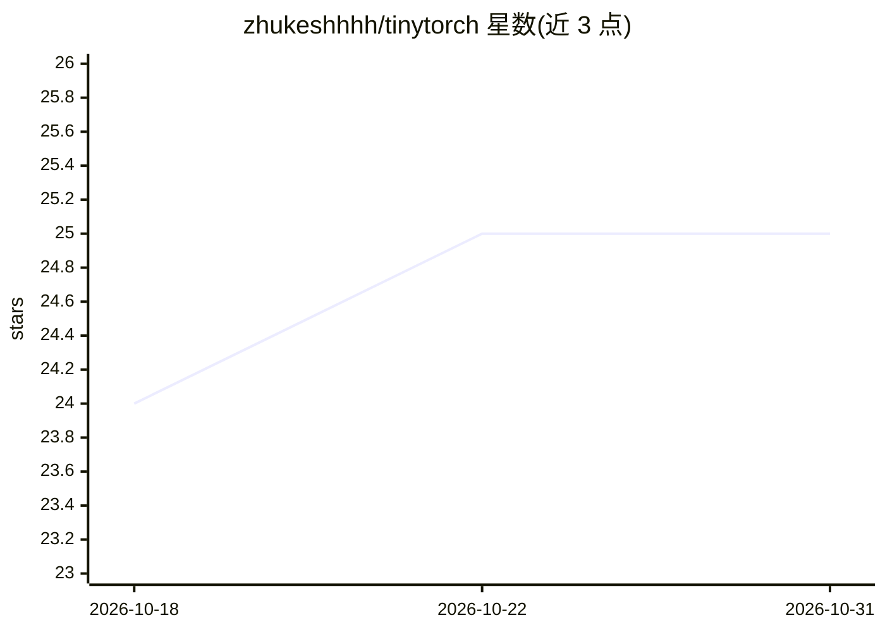

# zhukeshhhh/tinytorch

⭐ 25 · C++ · MIT · 推送 2026-07-07 · [GitHub](https://github.com/zhukeshhhh/tinytorch) · 个人维护

**教学用 C++ 张量库：理解深度学习框架底层机制**

面向学习者的 C++ 张量库，实现 2D 张量、基础线性代数运算、NumPy 风格广播、矩阵乘法（CPU 与 CUDA 双后端，CUDA 使用分块共享内存核函数）、ReLU、计算图与自动微分（backward 与梯度累积）。受 PyTorch 启发但刻意保持小型可读，整个实现分布在少量文件中，除标准库与可选 CUDA 工具链外无第三方依赖。通过 CMake 从源码构建，示例见 test.cpp。

## 筛选速览

| 维度 | 判定 | 备注 |
|---|---|---|
| AI 角色 | `ai-ecosystem` | LLM/agent 周边工具 |
| 许可风险 | `permissive` | MIT |
| 部署形态 | `None` |  |
| 模型依赖 | — | README 未给出锁定关系 |
| 硬件要求 | `cpu-ok` | |
| 安装摩擦 | `high` | 编译与系统依赖俱全 |
| 成熟度 | — | 结构信号不足 |

## 能力要点

- 2D 张量与 NumPy/PyTorch 风格广播运算
- CPU 与 CUDA 双后端，构造时通过 Device 选择
- 计算图记录输入并注册 gradfn 闭包，支持 backward 反向传播
- 分块共享内存 CUDA 矩阵乘法核函数

## 适用场景

- 学习深度学习框架的计算图与自动微分实现原理
- 阅读少量源码理解张量库的分层架构
- 练习编写与运行 CUDA 核函数（如分块 matmul）

## 场景标签

`教程课程` · 领域:学习与行业

## 证据(README 行号)

> L3: A minimal C++ tensor library for learning how deep learning frameworks work under the hood. tinytorch provides 2D te
> L15: - **Autograd-ready** — `accumulate_grad` and parent tracking are in place; a public `backward()` also implemented

## 星数曲线

2026-10-18 24 → 2026-10-31 25（+1）

---
*卡片 v1 · prompt 1.4 · 生成 2026-10-26 · 置信度 high · 依据 README sha `d49f9d79d138` · [字段定义](../../DATASET.md)*
