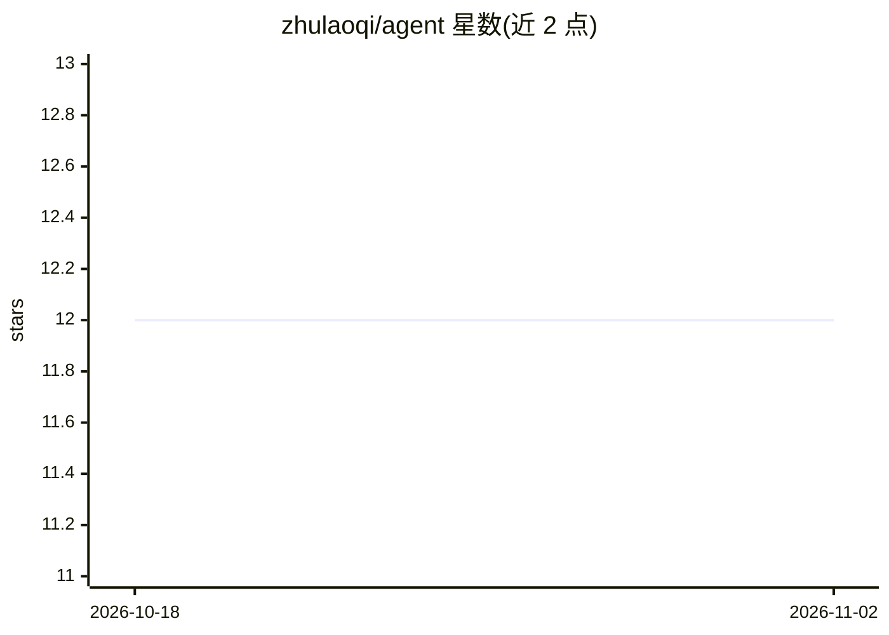

# zhulaoqi/agent

⭐ 12 · Java · 推送 2025-12-30 · [GitHub](https://github.com/zhulaoqi/agent) · 个人维护 · 中文 README

**基于 Spring AI Alibaba 的企业级智能体系统，含编排/审计/RAG**

以 Spring Boot 3.2 + Spring AI Alibaba 1.0.0-M2.3 + Vue 3 构建的智能体系统：提供 ReactAgent 对话、StateGraph 工作流编排、Multi-Agent 监督者协作、RAG 知识库问答、Human-in-the-Loop 审批、AI 文生图，以及 7 类 Hooks/Interceptors（审计日志、安全检查、Token 配额、消息修剪等）和 7 个内置工具（天气、SQL、脚本、文件等）。模型经阿里云百炼接入通义千问与通义万相，需自备 API 密钥。运行依赖 Java 17、MySQL 8、Redis 7、Node.js 18，提供 Docker Compose 与 Kubernetes 部署方式。

## 筛选速览

| 维度 | 判定 | 备注 |
|---|---|---|
| AI 角色 | `ai-native` | 本体是模型或模型工具 |
| 许可风险 | `none` | — |
| 部署形态 | `self-host` | docker 或自建部署 |
| 模型依赖 | — | README 未给出锁定关系 |
| 硬件要求 | — | 无带数字的原话,不猜 |
| 安装摩擦 | `low` | 无编译、无系统依赖或容器化 |
| 成熟度 | — | 结构信号不足 |

## 能力要点

- ReactAgent + StateGraph 工作流编排（条件路由、人工审批节点）
- 7 类 Hooks/Interceptors：审计、安全、Token 配额、性能监控等
- Multi-Agent 监督者协作与 RAG 知识库问答
- 完整审计日志记录 Token 消耗、工具调用与成本估算

## 适用场景

- 搭建带审计与配额管控的企业级对话智能体
- 用 StateGraph 编排需求分析→代码生成→审核的开发流程
- 构建知识库问答与多智能体协作应用

## 场景标签

`多智能体` `文档问答` `图像生成` · 领域:Agent 开发

## 证据(README 行号)

> L15: 这是一个**生产级AI智能体系统**，深度展示了 Spring AI Alibaba 框架的完整能力。项目包含企业级实践模式：ReactAgent、Hooks & Interceptors、StateGraph工作流、Multi-
> L152: 阿里云百炼            通义千问 + 通义万相

## 星数曲线

2026-10-18 12 → 2026-11-02 12（+0）

---
*卡片 v1 · prompt 1.4 · 生成 2026-10-31 · 置信度 high · 依据 README sha `3fb49f88144b` · [字段定义](../../DATASET.md)*
