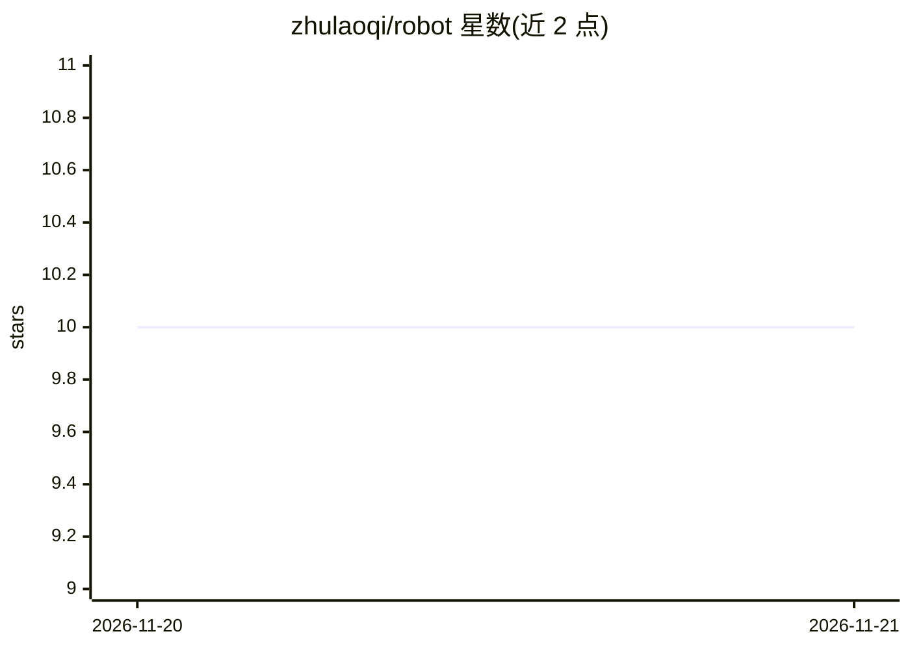

# zhulaoqi/robot

⭐ 10 · Java · 推送 2025-12-25 · [GitHub](https://github.com/zhulaoqi/robot) · 个人维护 · 中文 README

**基于 Langchain4j 的 Java 智能对话机器人学习项目**

以 Spring Boot + Langchain4j 构建的对话机器人系统，README 定位为 Langchain4j 学习实践与 AI 应用开发案例。功能覆盖多轮对话记忆（MySQL 持久化）、基于自研 MySQL 向量存储的 RAG、Text-to-SQL、Function Calling 工具调用、MCP 协议跨语言工具集成（Flask 实现 Python MCP Server）、Prompt 热更新与版本管理，以及 ReAct 等四种 Agent 模式的任务编排。后端为 HTTP/SSE 接口，附带 Vue 3 前端管理界面。常见问题中说明向量存储采用 MySQL 方案适合小规模数据，并推荐生产环境改用 PostgreSQL + pgvector 或 Milvus。

## 筛选速览

| 维度 | 判定 | 备注 |
|---|---|---|
| AI 角色 | `ai-native` | 本体是模型或模型工具 |
| 许可风险 | `none` | — |
| 部署形态 | `self-host` | docker 或自建部署 |
| 模型依赖 | — | README 未给出锁定关系 |
| 硬件要求 | — | 无带数字的原话,不猜 |
| 安装摩擦 | `low` | 无编译、无系统依赖或容器化 |
| 成熟度 | `idea` | |

## 能力要点

- 多轮对话记忆、RAG、Text-to-SQL、工具调用、MCP 协议集成
- 查询改写/多查询/Step-back/混合检索等高级 RAG 技术
- Prompt 集中管理与热更新，支持版本控制
- 提供 Docker Compose 一键部署与 Vue 3 前端管理界面

## 适用场景

- 学习 Langchain4j 在 Spring Boot 中的集成方式
- 搭建企业知识库问答或智能客服原型
- 用自然语言查询数据库生成 SQL
- 通过 MCP 协议集成 Java 与 Python 工具

## 场景标签

`聊天机器人` `RAG` `文档问答` `数据分析` · 领域:效率与自动化

## 证据(README 行号)

> L16: 这是一个基于 **Langchain4j** 框架和 **阿里云通义千问** 大模型构建的智能对话机器人系统。项目展示了如何在 Spring Boot
> L22: - 📚 **RAG 知识库** - 基于向量数据库的检索增强生成，提供专业领域问答
> L112: - **Langchain4j 1.0.1** - Java AI 开发框架

## 星数曲线

2026-11-20 10 → 2026-11-21 10（+0）

---
*卡片 v1 · prompt 1.4 · 生成 2026-11-20 · 置信度 mid · 依据 README sha `8f4703567289` · [字段定义](../../DATASET.md)*
