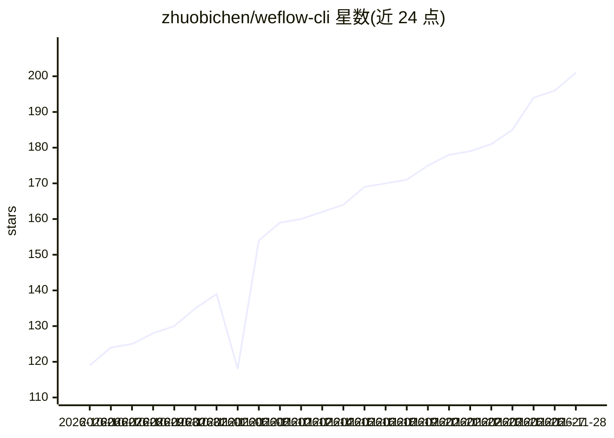

# zhuobichen/weflow-cli

⭐ 201 · Python · MIT · 推送 2026-11-27 · [GitHub](https://github.com/zhuobichen/weflow-cli) · 个人维护 · 中文 README

**把微信聊天与公众号数据本地化为可查询知识库的 CLI**

以命令行工具读取微信 4.x 本地 SQLCipher 数据库（只读打开），提供会话/消息查询、HTML/Excel/JSON 等格式导出、公众号 AI 摘要日报（可邮件推送）、收藏检索，以及语义搜索、概念图谱与 RAG 问答构成的个人知识库。内置 `ask` 问答命令：先取证据后组句，判定不了会明说。通过 MCP 接口暴露数据能力给 Claude Code 等客户端，另带可在微信与桌面面板对话的本地 AI 助手。需 Node.js 22.13+ 与 Python 3.10+；macOS 初始化路径标注未在真机验证。

## 筛选速览

| 维度 | 判定 | 备注 |
|---|---|---|
| AI 角色 | `ai-native` | 本体是模型或模型工具 |
| 许可风险 | `permissive` | MIT |
| 部署形态 | `library` | 以包/库形式分发 |
| 模型依赖 | locked-api |  |
| 硬件要求 | — | 无带数字的原话,不猜 |
| 安装摩擦 | `low` | 无编译、无系统依赖或容器化 |
| 成熟度 | — | 结构信号不足 |

## 能力要点

- 读取微信 4.x 本地 SQLCipher 数据库，数据库一律只读打开
- 聊天记录导出 Markdown/JSON/TXT/HTML/Excel，HTML 内嵌图片
- 公众号文章 AI 摘要日报，支持 systemd 定时与邮件推送
- MCP 接口接入 AI 编辑器，写入类调用需显式 confirm

## 适用场景

- 按联系人和时间检索、导出微信聊天记录留档
- 把订阅号文章自动整理成带摘要的每日简报
- 在 AI 编辑器里通过 MCP 查询自己的微信数据
- 本地知识库沉淀文章与聊天并做语义搜索

## 场景标签

`RAG` `语义搜索` `知识库管理` · 领域:知识与检索

## 证据(README 行号)

> L18: **WeFlow CLI 把微信变成你的本地第二大脑。** 四件事，全部在本机完成——不登录你的账号，也不上传聊天内容：
> L173: |AI 协作|通过 MCP 把文章、知识库、日报和受控的本地数据能力交给兼容客户端；工具清单以 `weflow-cli mcp-config` 和 `docs/MCP.md` 为准。|
> L344: 运行机制：守护进程通过微信官方 Bot 通道（iLink）长轮询收发消息，Agent 循环、三层记忆、数据库查询都在本机执行，仅提问与回复文本发给所配置的 LLM。隐私档位默认 `open`（正文原样可读）；会话 24 小时未活

## 星数曲线

2026-10-26 119 → 2026-11-28 201（+82）

---
*卡片 v1 · prompt 1.4 · 生成 2026-11-27 · 置信度 high · 依据 README sha `edb7c5c54e58` · [字段定义](../../DATASET.md)*
