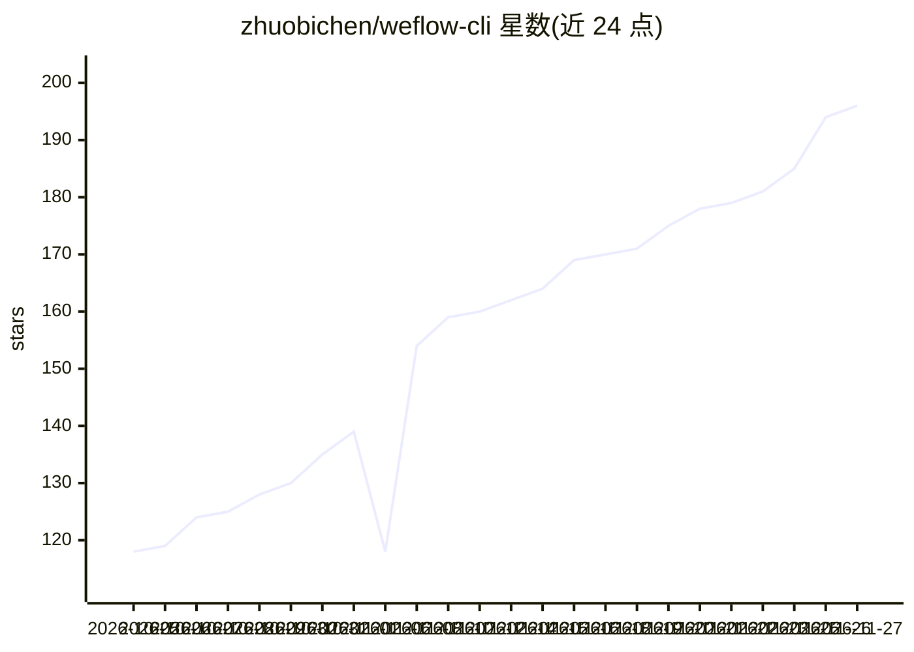

# zhuobichen/weflow-cli

⭐ 196 · Python · MIT · 推送 2026-11-26 · [GitHub](https://github.com/zhuobichen/weflow-cli) · 个人维护 · 中文 README

**给微信重度用户：本地查询导出聊天记录并构建知识库**

本地优先的微信数据 CLI：读取微信 4.x 本地 SQLCipher 数据库（只读），提供会话/消息查询、多格式导出、收藏检索、公众号 AI 摘要日报、语义搜索知识库与概念图谱。多个回顾类命令（bonds/promises 等）走规则判定、不调模型；`ask` 问答与 AI 助手默认在本机执行，仅提问文本发往所配置的 LLM。需 Node.js 22.13+ 与 Python 3.10+；Windows 验证完整，Linux 需额外授权步骤，macOS 路径未在真机验证。

## 筛选速览

| 维度 | 判定 | 备注 |
|---|---|---|
| AI 角色 | `ai-native` | 本体是模型或模型工具 |
| 许可风险 | `permissive` | MIT |
| 部署形态 | `library` | 以包/库形式分发 |
| 模型依赖 | — | README 未给出锁定关系 |
| 硬件要求 | — | 无带数字的原话,不猜 |
| 安装摩擦 | `low` | 无编译、无系统依赖或容器化 |
| 成熟度 | — | 结构信号不足 |

## 能力要点

- 读取微信 4.x 本地 SQLCipher 数据库，只读打开不写回
- 聊天导出 Markdown/JSON/TXT/HTML/Excel，HTML 内嵌图片与语音转写
- 公众号日报带 AI 摘要，可 systemd 定时生成并邮件推送
- MCP 接口把本地数据能力交给 AI 编辑器等客户端

## 适用场景

- 把聊天记录按联系人导出成可直接翻阅的 HTML
- 把订阅号文章整理成带摘要的每日简报并邮件推送
- 在 AI 编辑器里通过 MCP 查询本地微信数据
- 用自然语言问"我答应过谁什么"并核对原话证据

## 场景标签

`语义搜索` `语音识别` `知识库管理` · 领域:知识与检索

## 证据(README 行号)

> L18: **WeFlow CLI 把微信变成你的本地第二大脑。** 四件事，全部在本机完成——不登录你的账号，也不上传聊天内容：
> L25: |🧠 **知识库**|文章与聊天沉淀成可语义搜索的笔记与概念图谱|`weflow-cli search` · `weflow-cli wiki`|
> L68: **问一句话，每条结论都挂原话**（`ask` 是上面这些命令的问答外壳）：

## 星数曲线

2026-10-25 118 → 2026-11-27 196（+78）

---
*卡片 v1 · prompt 1.4 · 生成 2026-11-26 · 置信度 mid · 依据 README sha `663cb055492a` · [字段定义](../../DATASET.md)*
