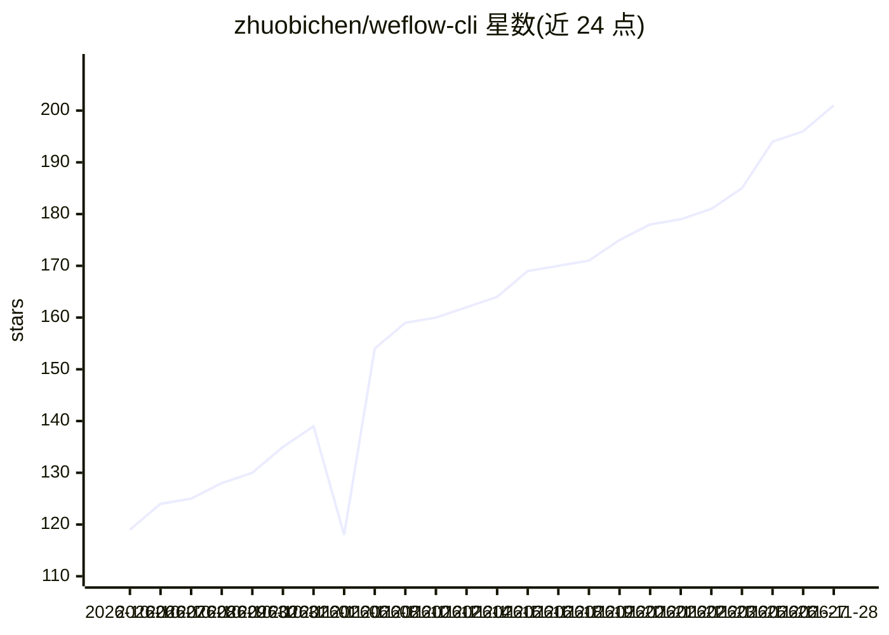

# zhuobichen/weflow-cli

⭐ 201 · Python · MIT · 推送 2026-11-27 · [GitHub](https://github.com/zhuobichen/weflow-cli) · 个人维护 · 中文 README

**把微信聊天与公众号数据在本地变成可查询知识库的 CLI**

本地优先的微信数据工具，只读本地数据库（微信 4.x SQLCipher），提供聊天记录查询与多格式导出、公众号 AI 摘要日报、收藏检索、语义搜索与概念图谱知识库，以及 RAG 问答。AI 助手通过微信官方 Bot 通道接入，Agent 循环与三层记忆在本机执行，仅提问与回复文本发给所配置的 LLM；内置每日处理上限与白名单机制。安装需 Node.js 22.13+ 与 Python 3.10+；支持 Windows 与 Linux，macOS 初始化未在真机验证。

## 筛选速览

| 维度 | 判定 | 备注 |
|---|---|---|
| AI 角色 | `ai-native` | 本体是模型或模型工具 |
| 许可风险 | `permissive` | MIT |
| 部署形态 | `library` | 以包/库形式分发 |
| 模型依赖 | — | README 未给出锁定关系 |
| 硬件要求 | — | 无带数字的原话,不猜 |
| 安装摩擦 | `low` | 无编译、无系统依赖或容器化 |
| 成熟度 | — | 结构信号不足 |

## 能力要点

- 只读打开微信 4.x SQLCipher 本地数据库，导出 HTML/Excel/Markdown/JSON/TXT
- 公众号文章 AI 摘要日报，可 systemd 定时生成并邮件推送
- MCP 接口将本地数据能力交给 Claude Code 等兼容客户端
- 语义搜索、RAG 问答与 3D/2D 概念图谱页面

## 适用场景

- 把微信聊天记录导出成可翻阅和归档的文件
- 给订阅的公众号生成带摘要的每日简报
- 通过 MCP 让 AI 编辑器读取我的本地微信数据
- 在微信里用自然语言查询自己的聊天与收藏

## 场景标签

`RAG` `语义搜索` `知识库管理` · 领域:知识与检索

## 证据(README 行号)

> L18: **weflow-cli 把微信变成你的本地第二大脑。** 四件事，全部在本机完成——不登录你的账号，也不上传聊天内容：
> L25: |🧠 **知识库**|文章与聊天沉淀成可语义搜索的笔记与概念图谱|`weflow-cli search` · `weflow-cli wiki`|
> L344: 运行机制：守护进程通过微信官方 Bot 通道（iLink）长轮询收发消息，Agent 循环、三层记忆、数据库查询都在本机执行，仅提问与回复文本发给所配置的 LLM。隐私档位默认 `open`（正文原样可读）；会话 24 小时未活

## 星数曲线

2026-10-26 119 → 2026-11-28 201（+82）

---
*卡片 v1 · prompt 1.4 · 生成 2026-11-28 · 置信度 mid · 依据 README sha `1d3fb8549427` · [字段定义](../../DATASET.md)*
