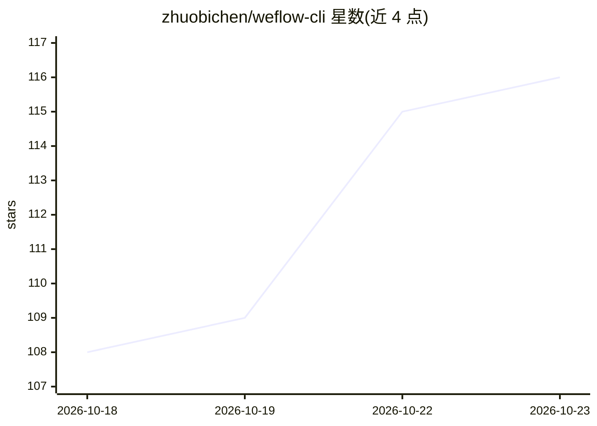

# zhuobichen/weflow-cli

⭐ 116 · Python · MIT · 推送 2026-10-22 · [GitHub](https://github.com/zhuobichen/weflow-cli) · 个人维护 · 中文 README

**本地优先的微信数据 CLI：聊天记录查询导出、日报、知识库与 AI 助手**

面向个人微信用户的本地数据处理工具：在本机读取微信聊天记录、收藏、朋友圈与微信读书数据，提供查询、多格式导出（HTML/Markdown/Excel/JSON）、关系回顾类命令（谁在等我回话、待办承诺等，只读本地库不调模型）；Python 工作流把公众号文章整理成带 AI 摘要的日报，并构建可语义搜索的个人知识库。AI 能力包括 DeepSeek/OpenAI 兼容端点驱动的微信内助手（三层记忆、PII 脱敏、每日 100 条上限、白名单门槛）与 MCP 接口供 Claude Code 等编辑器调用。密钥以机器绑定 AES-256-GCM 加密存储本机，语音转写用本机 Whisper。支持 Windows 与 Linux，macOS 需手动提供凭据。

## 筛选速览

| 维度 | 判定 | 备注 |
|---|---|---|
| AI 角色 | `ai-enhanced` | 去掉 AI 部分产品仍成立 |
| 许可风险 | `permissive` | MIT |
| 部署形态 | `library` | 以包/库形式分发 |
| 模型依赖 | local-ok | 支持本地模型 |
| 硬件要求 | — | 无带数字的原话,不猜 |
| 安装摩擦 | `low` | 无编译、无系统依赖或容器化 |
| 成熟度 | — | 结构信号不足 |

## 能力要点

- 聊天记录/收藏/朋友圈/微信读书的本地查询与 Markdown/JSON/TXT/HTML/Excel 导出
- 公众号日报：抓取文章、AI 摘要分类、本地阅读页
- 微信内本地 AI 助手：自然语言查询本地数据，三层记忆与 PII 脱敏（可选 ollama 完全本地引擎）
- MCP 接口把文章、知识库与受控本地数据能力交给 Claude Code 等客户端

## 适用场景

- 把微信聊天记录导出成带图片的 HTML 或 Markdown 存档
- 每天自动生成公众号文章的 AI 摘要日报
- 在微信里用自然语言查询自己的聊天记录、收藏和待办
- 把微信数据通过 MCP 接入 Claude Code 等 AI 编辑器

## 场景标签

 · 领域:个人数据管理/知识库

## 证据(README 行号)

> L18: **WeFlow CLI 把微信变成你的本地第二大脑**：在本机读取和查询聊天记录、导出可读 HTML；把公众号文章整理成带 AI 摘要的日报（可邮件推送）；读取微信收藏；构建可语义搜索的知识库（连语音消息也能搜）；并通过 MCP
> L48: **几个微信给不出答案的问题**（都只读本地库，不联网、不调模型）：
> L86: |聊天记录|查询会话、联系人和消息；导出 **Markdown / JSON / TXT / HTML / Excel**。Markdown 导出把图片**落盘**到 `<会话>_assets/`、正文用相对路径引用（喂给编辑器或

## 星数曲线

2026-10-18 108 → 2026-10-23 116（+8）

---
*卡片 v1 · prompt 1.4 · 生成 2026-10-23 · 置信度 mid · 依据 README sha `980b462cbc03` · [字段定义](../../DATASET.md)*
