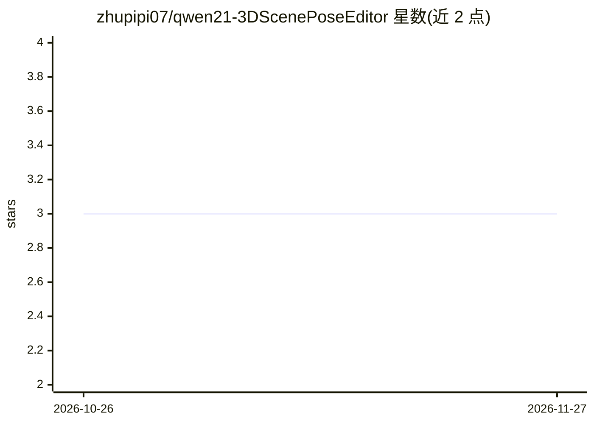

# zhupipi07/qwen21-3DScenePoseEditor

⭐ 3 · Python · 推送 2026-10-22 · [GitHub](https://github.com/zhupipi07/qwen21-3DScenePoseEditor) · 个人维护 · 中文 README

**ComfyUI 插件：浏览器里摆 3D 人物道具生成控制图供 Qwen 出图**

以 ComfyUI 自定义节点形式安装的 3D 场景与姿势编辑器，在浏览器中摆放人物、道具与调整镜头，生成 3D 控制图、角色参考和场景参考，随后交给 Qwen Image 2.1 生成图像。安装方式为将插件文件夹复制到 ComfyUI 的 custom_nodes 目录，依赖 ComfyUI 环境运行。README 可见内容仅覆盖定位与安装方式。

## 筛选速览

| 维度 | 判定 | 备注 |
|---|---|---|
| AI 角色 | `ai-enhanced` | 去掉 AI 部分产品仍成立 |
| 许可风险 | `none` | — |
| 部署形态 | `None` |  |
| 模型依赖 | — | README 未给出锁定关系 |
| 硬件要求 | — | 无带数字的原话,不猜 |
| 安装摩擦 | `low` | 无编译、无系统依赖或容器化 |
| 成熟度 | — | 结构信号不足 |

## 能力要点

- 浏览器内 3D 摆放人物、道具与调整镜头
- 生成 3D 控制图、角色参考与场景参考
- 以 ComfyUI custom_nodes 插件形式安装

## 适用场景

- 为 ComfyUI 图像生成流程准备姿势与构图控制图
- 摆好角色与场景后生成参考图供出图

## 场景标签

`图像生成` · 领域:内容生成

## 证据(README 行号)

> L3: ComfyUI 的 3D 场景与姿势编辑器：在浏览器里摆人物、摆道具、调镜头，生成 3D 控制图、角色参考和场景参考，再交给 Qwen Image 2.1 出图。
> L7: 把仓库里的 `ComfyUI-3DScenePoseEditor` 文件夹复制到：

## 星数曲线

2026-10-26 3 → 2026-11-27 3（+0）

---
*卡片 v1 · prompt 1.4 · 生成 2026-11-26 · 置信度 mid · 依据 README sha `c614606dfe37` · [字段定义](../../DATASET.md)*
