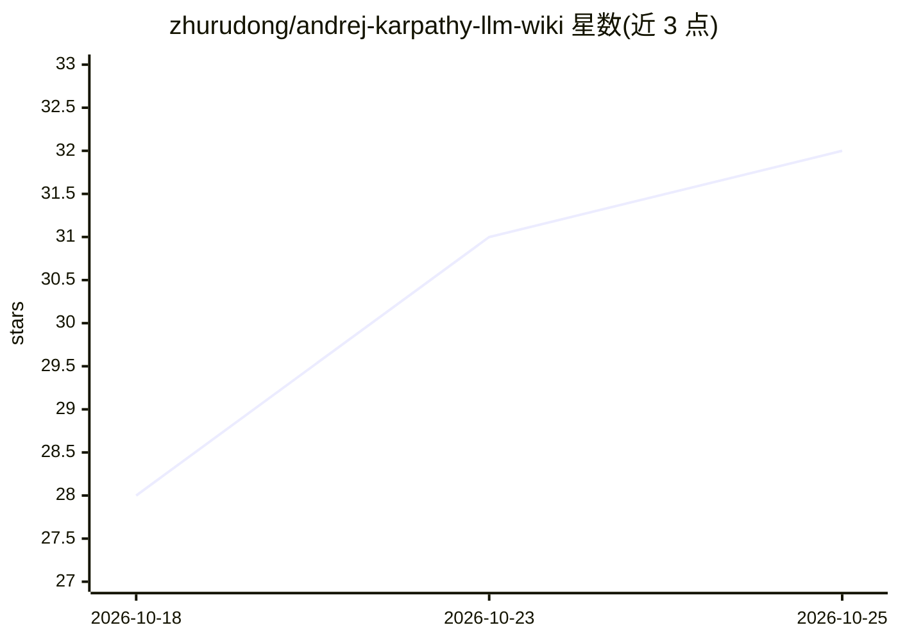

# zhurudong/andrej-karpathy-llm-wiki

⭐ 32 · Shell · 推送 2026-10-16 · [GitHub](https://github.com/zhurudong/andrej-karpathy-llm-wiki) · 个人维护 · 中文 README

**单文件 CLAUDE.md 模板：把任意 LLM CLI 变成个人知识库**

一个 CLAUDE.md 模板项目，配合 Claude Code、Codex CLI、OpenCode 等会读取项目规则文件的 LLM CLI 使用：通过自然语言命令（如 ingest）让 LLM 抓取网页、保存原文、生成摘要、抽取实体与概念页并维护索引，形成以 markdown 文件为载体、wiki-link 为知识图谱的本地知识库。无后端、无向量库、无 RAG 框架。提供一行安装脚本与手动安装两种方式，raw/ 层保存不可变原文、wiki/ 层存放 LLM 可再生成的理解。

## 筛选速览

| 维度 | 判定 | 备注 |
|---|---|---|
| AI 角色 | `ai-ecosystem` | LLM/agent 周边工具 |
| 许可风险 | `none` | — |
| 部署形态 | `None` |  |
| 模型依赖 | — | README 未给出锁定关系 |
| 硬件要求 | — | 无带数字的原话,不猜 |
| 安装摩擦 | `low` | 无编译、无系统依赖或容器化 |
| 成熟度 | — | 结构信号不足 |

## 能力要点

- 单个 CLAUDE.md 文件即完整规则，经 AGENTS.md 符号链接跨 CLI 复用
- raw/（不可变原文）+ wiki/（LLM 可再生成理解）两层设计
- ingest/问答/lint wiki 三类工作流：抓取归档、跨源综合、检查断链与矛盾
- 纯 markdown 输出，可用任意编辑器/Obsidian/Logseq/grep 浏览

## 适用场景

- 丢入 arXiv 论文链接，让 LLM 生成摘要并关联已有概念
- 定期摄入行业博客，逐渐形成主题综述
- 把 LLM 综合的回答存入 synthesis/，沉淀个人观点库
- 推送到 Git，团队成员各自用 LLM CLI 维护同一知识库

## 场景标签

`知识库管理` `文档问答` · 领域:知识与检索

## 证据(README 行号)

> L5: > One `CLAUDE.md` = a self-maintaining local knowledge base. No backend, no vector DB, no RAG framework.
> L22: This project takes a third path: **let the LLM do the organizing, use markdown files as the substrate, use wiki-lin
> L60: |CLI|Convention file|

## 星数曲线

2026-10-18 28 → 2026-10-25 32（+4）

---
*卡片 v1 · prompt 1.4 · 生成 2026-10-25 · 置信度 high · 依据 README sha `155e04c508fb` · [字段定义](../../DATASET.md)*
