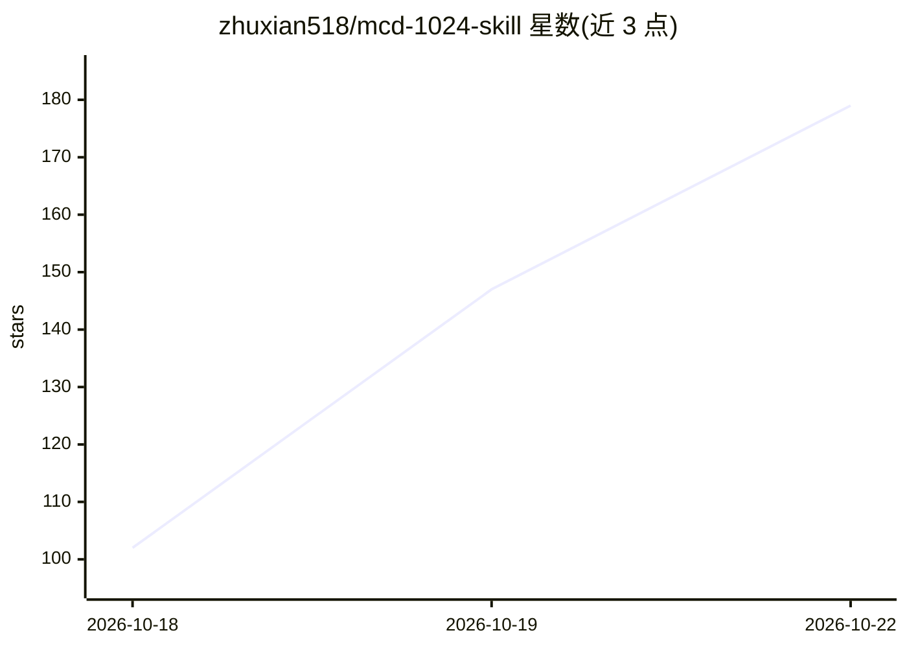

# zhuxian518/mcd-1024-skill

⭐ 179 · MIT · 推送 2026-10-20 · [GitHub](https://github.com/zhuxian518/mcd-1024-skill) · 个人维护 · 中文 README

**麦当劳点餐推荐 Skill：给一个答案，附本地记忆与价格指数**

面向麦当劳中国大陆会员的 MCP Skill（SKILL.md 指令 + JSON 数据），运行于任意支持 MCP 的 AI 客户端（WorkBuddy / Cherry Studio / Cursor 等）。功能为三层：按用户一句话约束（预算/营养）给出唯一推荐及理由；基于本地记忆银行（data/memory.json，官方接口仅可查最近10单）生成「老朋友」「尝个新」两个备选；每日附麦麦巨无霸指数（首期实测11城门店价格）。写操作需用户逐项确认。仓库本身无独立程序、无安装脚本，需自备 MCP Token。

## 筛选速览

| 维度 | 判定 | 备注 |
|---|---|---|
| AI 角色 | `ai-native` | 本体是模型或模型工具 |
| 许可风险 | `permissive` | MIT |
| 部署形态 | `None` |  |
| 模型依赖 | — | README 未给出锁定关系 |
| 硬件要求 | — | 无带数字的原话,不猜 |
| 安装摩擦 | `low` | 无编译、无系统依赖或容器化 |
| 成熟度 | `idea` | |

## 能力要点

- 唯一推荐 + 两个基于本地订单记忆的备选
- 本地记忆银行存储订单/偏好/口味簇（data/memory.json）
- 麦麦巨无霸指数：11 城门店价格采样数据
- 领券、下单等写操作须用户逐项确认

## 适用场景

- 让 AI 客户端替我决定午饭吃什么并说明理由
- 基于自己的点餐历史获得个性化备选推荐
- 查看所在城市巨无霸价格在全国的档位

## 场景标签

 · 领域:生活服务/餐饮 AI 应用

## 证据(README 行号)

> L3: **只给一个答案的麦当劳点餐 Skill**——它记得你点过的每一单，也顺带告诉你今天全国的巨无霸卖多少钱。
> L19: 麦麦老友记换了个思路：**你不用挑，老友替你挑。** 你只要说一句"今天中午吃啥，三十以内，多点蛋白"，它就回你一个答案——为什么是它、营养达没达标、券后多少钱，三行说清。下面再补两个备选：一个是你点过很多次、上次还给过五星的"老
> L84: 2. 把本仓库放入你的 AI 客户端工作目录，加载 SKILL.md

## 星数曲线

2026-10-18 102 → 2026-10-22 179（+77）

---
*卡片 v1 · prompt 1.4 · 生成 2026-10-22 · 置信度 mid · 依据 README sha `88aab1c21bee` · [字段定义](../../DATASET.md)*
