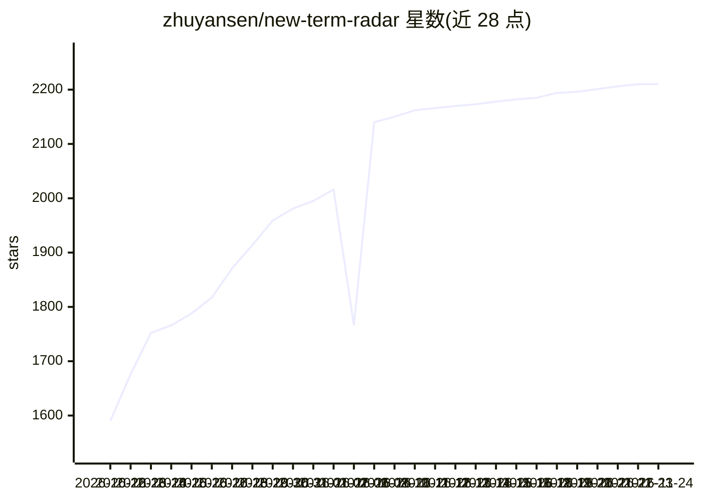

# zhuyansen/new-term-radar

⭐ 2,210 · Python · MIT · 推送 2026-11-22 · [GitHub](https://github.com/zhuyansen/new-term-radar) · [官网](https://agentskillshub.top/skill/zhuyansen/new-term-radar/) · 个人维护 · 中文 README

**面向 SEO 与内容站点的 AI 新词每日雷达报告**

每日扫描 X、Hugging Face trending、GitHub 突增仓库、站点地图、Product Hunt 等六类信号源，捕捉新模型、新产品与新仓库的名称，并生成含搜索量、趋势形态与首页竞争度判定的关键词表。支持命令行、三个 Agent Skills、MCP server 与 pains 命令四种使用方式，附 14 天命中率回查机制。依赖 AIsa/GoAnyAPI/TrustMRR 等 key，运行成本按调用计价，示例配置约每月 $15。面向围绕新词做页面、文章或产品的运营者。

## 筛选速览

| 维度 | 判定 | 备注 |
|---|---|---|
| AI 角色 | `ai-native` | 本体是模型或模型工具 |
| 许可风险 | `permissive` | MIT |
| 部署形态 | `library` | 以包/库形式分发 |
| 模型依赖 | — | README 未给出锁定关系 |
| 硬件要求 | — | 无带数字的原话,不猜 |
| 安装摩擦 | `medium` | 含编译或系统依赖之一 |
| 成熟度 | — | 结构信号不足 |

## 能力要点

- 读取 X、Hugging Face、GitHub、sitemaps、Product Hunt 等信号源比关键词工具更早捕捉新名称
- name judge 用小模型判定词条是专名还是常用词
- 关键词表含 generic 搜索词、首页竞争度（open/crowded/mixed）、KGR 与决策建议
- 以 CLI、Agent Skills、MCP server 多种形态提供

## 适用场景

- 为新发布的 AI 模型或产品抢先制作相关页面
- newsletter 与目录站第一时间获知新词条
- 核验自己站点对新词的首批搜索曝光并决定是否跟进建页

## 场景标签

`网页抓取` · 领域:效率与自动化

## 证据(README 行号)

> L27: A daily report of the names that are starting to surge in AI: new models, products, tools and repos, caught where t
> L53: |① X|Names the accounts in your list used for the first time in 60 days|AIsa key|$0.003 per account per run|
> L88: 2. **Phrases**: a model reads the evidence and writes the keyword an ordinary person would type for each job it see

## 星数曲线

2026-10-22 1,590 → 2026-11-24 2,210（+620）

---
*卡片 v1 · prompt 1.4 · 生成 2026-11-23 · 置信度 low · 依据 README sha `2d0652864af7` · [字段定义](../../DATASET.md)*
