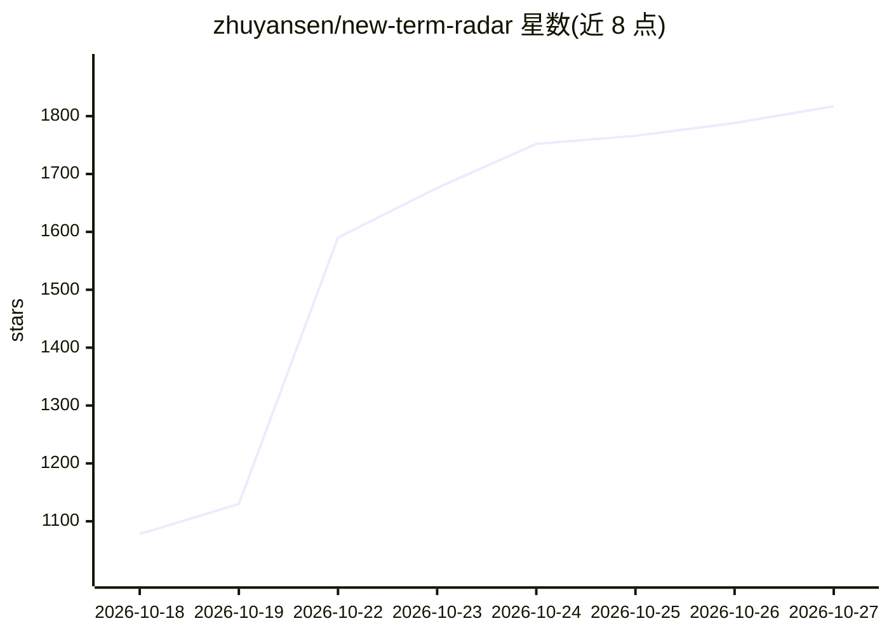

# zhuyansen/new-term-radar

⭐ 1,817 · Python · MIT · 推送 2026-10-26 · [GitHub](https://github.com/zhuyansen/new-term-radar) · 个人维护 · 中文 README

**AI 新词日报雷达：新模型/产品/仓库名出现当天即捕获并产出关键词表**

面向围绕新词做页面、文章或产品的 SEO 从业者、通讯作者与目录站运营者。工具每天读取六类信号：X 账号首次使用的名字、Hugging Face 趋势榜、GitHub 爆发仓库（14 天内日均 200+ star）、AI 工具目录站点 sitemap 新词、Reddit 请求、新收款链接站点与 TrustMRR 收入数据；再用小模型判定名词属性、从证据生成普通人会搜索的通用关键词，结合 Google Ads 体量与 Trends 走势输出 prioritize/watch/skip 决策及首页竞争度检查。多数信号需 AIsa API key，示例配置月成本约 $15；可通过 CLI、三个 Agent Skills、MCP 服务器或 pains 命令使用。

## 筛选速览

| 维度 | 判定 | 备注 |
|---|---|---|
| AI 角色 | `ai-enhanced` | 去掉 AI 部分产品仍成立 |
| 许可风险 | `permissive` | MIT |
| 部署形态 | `library` | 以包/库形式分发 |
| 模型依赖 | — | README 未给出锁定关系 |
| 硬件要求 | — | 无带数字的原话,不猜 |
| 安装摩擦 | `medium` | 含编译或系统依赖之一 |
| 成熟度 | `idea` | |

## 能力要点

- 六类信号在关键词工具收录之前捕获新名字（X/Hugging Face/GitHub 爆发/sitemap/Reddit/新收款站点）
- 模型从证据帖子生成通用关键词并给出 prioritize/watch/skip 决策
- 关键词表含首页竞争度检查（open/crowded/mixed）与 14 天后 Google Trends 复核
- 支持命令行、Agent Skills、MCP 服务器与 pains 命令多种使用方式

## 适用场景

- AI 工具站 SEO：在新词被关键词工具收录前建页面抢占流量
- 通讯/目录站运营者追踪当天出现的新模型与新仓库名字
- 评估一个新名词背后的既有搜索需求规模与首页竞争程度

## 场景标签

 · 领域:SEO/关键词研究

## 证据(README 行号)

> L27: A daily report of the names that are starting to surge in AI: new models, products, tools and repos, caught where t
> L29: Built for people who make pages, posts or products around new terms: SEO for AI tool sites, newsletters, directorie
> L47: How the radar works: six signals, a name judge, the keyword table with its page-one check, a daily report and a 14-

## 星数曲线

2026-10-18 1,078 → 2026-10-27 1,817（+739）

---
*卡片 v1 · prompt 1.4 · 生成 2026-10-21 · 置信度 low · 依据 README sha `2c31583a5411` · [字段定义](../../DATASET.md)*
