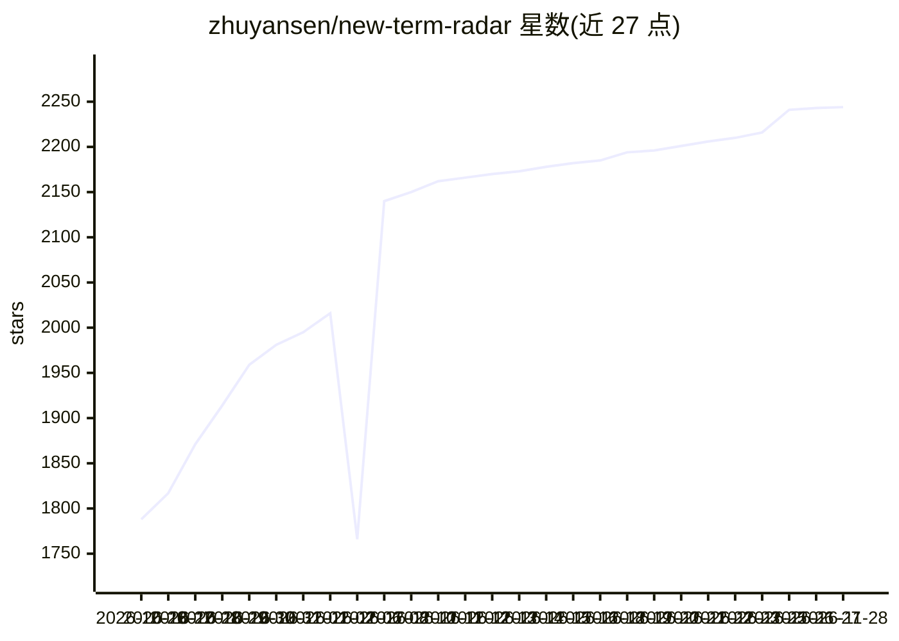

# zhuyansen/new-term-radar

⭐ 2,244 · Python · MIT · 推送 2026-11-26 · [GitHub](https://github.com/zhuyansen/new-term-radar) · [官网](https://agentskillshub.top/skill/zhuyansen/new-term-radar/) · 个人维护 · 中文 README

**面向 SEO 与内容创作者的每日 AI 新词雷达报告**

每日从 X、Hugging Face 趋势榜、GitHub 新兴仓库、网站 sitemap、Product Hunt 等来源捕捉新出现的模型/产品/仓库名称，并用模型把每个新名转化为对应的通用搜索词，生成带搜索量、竞争度与优先级判定的关键词表。可通过命令行、MCP server、Agent Skills 使用。多数信号依赖 Glasser/AIsa/GoAnyAPI 等付费 API key，按查询计费，示例配置月成本约 $33-41。

## 筛选速览

| 维度 | 判定 | 备注 |
|---|---|---|
| AI 角色 | `ai-enhanced` | 去掉 AI 部分产品仍成立 |
| 许可风险 | `permissive` | MIT |
| 部署形态 | `library` | 以包/库形式分发 |
| 模型依赖 | — | README 未给出锁定关系 |
| 硬件要求 | — | 无带数字的原话,不猜 |
| 安装摩擦 | `medium` | 含编译或系统依赖之一 |
| 成熟度 | — | 结构信号不足 |

## 能力要点

- 六类信号源每日采集：X、Hugging Face 趋势、GitHub 爆发仓库、sitemap、新站、上架/变现站点
- 关键词表同时给出新名称与其背后的通用搜索词，含搜索量与首页竞争判定
- 提供 CLI、三个 Agent Skills 与 MCP server 多种使用方式
- 14 天后用 DataForSEO Trends 回验各信号的前瞻命中率

## 适用场景

- 为 AI 工具站在新词出现当天抢建内容页面
- newsletter 作者追踪最新模型与产品名称
- 目录站维护者发现新收录对象与热门搜索变体

## 场景标签

 · 领域:SEO/关键词情报

## 证据(README 行号)

> L27: A daily report of the names that are starting to surge in AI: new models, products, tools and repos, caught where t
> L29: Built for people who make pages, posts or products around new terms: SEO for AI tool sites, newsletters, directorie
> L68: |Name judge|A small model scores every term: the name of one specific thing, or a common word?|a model: your own Op

## 星数曲线

2026-10-26 1,788 → 2026-11-28 2,244（+456）

---
*卡片 v1 · prompt 1.4 · 生成 2026-11-27 · 置信度 low · 依据 README sha `86755fdb1e31` · [字段定义](../../DATASET.md)*
