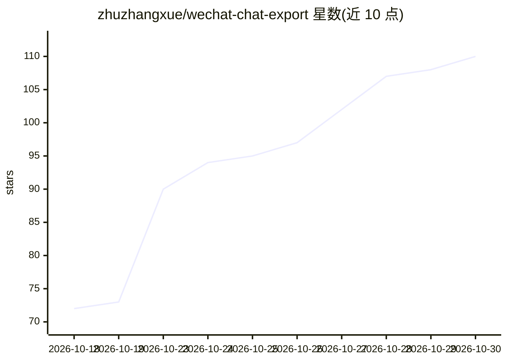

# zhuzhangxue/wechat-chat-export

⭐ 110 · Python · Apache-2.0 · 推送 2026-10-13 · [GitHub](https://github.com/zhuzhangxue/wechat-chat-export) · 个人维护 · 中文 README

**Windows 微信聊天记录本地导出工具，产出面向 LLM 的文本**

读取 Windows 微信 4.1.12+ 本机数据库，将私聊/群聊导出为 TXT、Markdown、JSON 三种格式，供 GPT、Claude、Gemini 等大模型读取或自行留存检索；支持批量导出全部可识别聊天、图片/文件/语音/视频缓存导出、聊天预览。发送者身份基于 Name2Id 分片与稳定 username 映射，不猜测。v1.3.4 起敏感解密材料使用一次性临时目录并自动清理；仅支持 Windows，媒体只能导出本机仍有缓存的部分。可选本地 SenseVoice 语音转文字（默认关闭）。

## 筛选速览

| 维度 | 判定 | 备注 |
|---|---|---|
| AI 角色 | `ai-enhanced` | 去掉 AI 部分产品仍成立 |
| 许可风险 | `permissive` | Apache-2.0 |
| 部署形态 | `desktop` | 安装包/桌面程序 |
| 模型依赖 | — | README 未给出锁定关系 |
| 硬件要求 | — | 无带数字的原话,不猜 |
| 安装摩擦 | `low` | 无编译、无系统依赖或容器化 |
| 成熟度 | — | 结构信号不足 |

## 能力要点

- TXT/Markdown/JSON 三种导出格式，JSON 保留发送者解析状态等结构字段
- 批量导出全部聊天，会话目录由稳定 username 派生避免同名歧义
- 数据库密钥与解密缓存使用一次性临时工作目录，导出结束自动清理
- 可选本地 SenseVoice Small Int8 语音转文字，识别过程不上传语音

## 适用场景

- 把与某位好友或群聊的完整记录导出后交给大模型分析或总结
- 留存微信聊天记录用于本地检索和二次处理
- 在不上传语音的前提下批量转写聊天语音为文字

## 场景标签

 · 领域:个人数据导出/LLM 数据准备

## 证据(README 行号)

> L3: 把 Windows 微信 4.1.12+ 的聊天记录导出为 TXT、Markdown 和 JSON，方便交给 GPT、Claude、Gemini 等大模型读取，也可以自己留存、检索或继续处理。
> L224: 勾选后会自动同时导出语音，并使用 SenseVoice 在本机完成识别。
> L378: 本项目的大部分早期设计、代码实现、问题排查和文档整理是在 ChatGPT 的协助下完成的。

## 星数曲线

2026-10-18 72 → 2026-10-30 110（+38）

---
*卡片 v1 · prompt 1.4 · 生成 2026-10-23 · 置信度 mid · 依据 README sha `70971f1c6032` · [字段定义](../../DATASET.md)*
